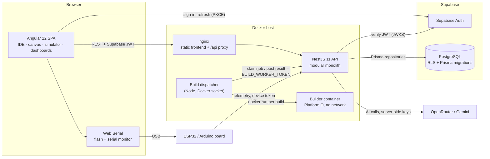

# Architecture

"System Overview" describes the system as built today. The sections from "Product Goal" to "Future Scalability" describe the **target** architecture. The sections from "Current State" onward record how the code moved from the legacy system towards that target.

The evidence behind the current-state summary is in `docs/LEGACY_AUDIT.md`.

# System Overview

As built, 2026-10-18. Known gaps against the target: `docs/KNOWN_ISSUES.md`.

## Diagram



A rendered copy is in `docs/diagrams/system-overview.png`.

Request path, in order:

1. The browser signs in with Supabase Auth and holds the Supabase session.
2. Every API call carries the Supabase access token. `SupabaseAuthGuard` verifies it
   against the project's JWKS and establishes identity only.
3. `AuthorizationService` reads the platform role and workspace membership from the
   database on every request, so a demotion takes effect immediately.
4. The service applies business rules; a repository contract, implemented with
   Prisma, reads or writes PostgreSQL.
5. Errors are mapped centrally by `AllExceptionsFilter` to
   `{ error: { code, message, requestId } }`.

Firmware never compiles in the API. The API stores a build job; the dispatcher claims
it and runs one locked-down container per build; the result and images return to the
API, and the browser flashes the board.

## Technology choices

| Layer | Technology | Why it was chosen |
| --- | --- | --- |
| Frontend | Angular 22, standalone components, Signals | Framework-native routing, DI, forms, and lazy loading for a large app with many feature areas |
| Styling | Tailwind CSS 4 | Utility classes keep feature styles local and consistent |
| Code editor | Monaco | The VS Code editor engine: syntax highlighting, models with undo history |
| Board flashing | esptool-js, STK500 over Web Serial | Flashing happens on the user's machine; the server never touches USB |
| Backend | NestJS 11 | DI, guards, pipes, filters, and modules map directly onto the modular-monolith rules in `AGENTS.md` |
| Database | Supabase PostgreSQL | Managed Postgres with RLS as defence in depth, alongside Auth and Storage in one platform |
| Data access | Prisma 7 behind repository contracts | Typed queries and one migration history (ADR-001). Repositories keep ORM types out of services |
| Authentication | Supabase Auth | The platform stores no passwords and issues no tokens. Email verification, reset, MFA, and OAuth come built in (ADR-003) |
| Project files | PostgreSQL `TEXT` rows | Small autosaved sources; one atomic, versioned write per save (ADR-004) |
| Build isolation | Docker container per build, PostgreSQL job table as queue | Untrusted code never runs next to platform secrets (ADR-002) |
| AI | OpenRouter (plus Gemini for the advisor) | One API over many models with runtime ranking and fallback; keys stay on the server (ADR-007, ADR-009) |
| Deployment | Docker Compose, nginx | One host, reproducible images pinned by digest |

## Folder structure

```
iot-hub/
├── backend/                      NestJS API
│   ├── prisma/
│   │   ├── schema.prisma            Single schema source of truth
│   │   └── migrations/              Versioned SQL migrations (incl. RLS, triggers)
│   └── src/
│       ├── main.ts                  Bootstrap: /api prefix, Helmet, CORS, validation, filter
│       ├── common/                  config/ (Supabase, security), filters/, http/ (request id)
│       ├── prisma/                  PrismaService (primary + optional read replica)
│       └── modules/                 One folder per domain
│           ├── auth/                Supabase token guard, profile (/auth/me), sign-in history
│           ├── authorization/       Platform role and workspace role checks
│           ├── users/, workspaces/  Profiles, workspaces, membership
│           ├── projects/            Projects, files, components, connections, board catalog,
│           │                        pin-assignment engine
│           ├── build/               Build queue and worker endpoints (never compiles)
│           ├── libraries/           PlatformIO Registry library manager
│           ├── devices/             Device tokens, telemetry ingestion, controls
│           ├── dashboards/          Dashboards, datastreams, templates
│           ├── ai/                  Admin assistant, project assistant, IoT advisor, providers
│           ├── ai-credits/          AI model settings and credit limits
│           ├── billing/             Plans and entitlements (quotas)
│           ├── community/           Posts, comments, tags, votes
│           ├── search-history/      Per-user recent searches
│           ├── admin-users/, admin-database/, admin-monitoring/
│           └── workspace/           Deprecated filesystem routes (to be removed)
├── frontend/                      Angular SPA
│   └── src/app/
│       ├── core/                    guards/, interceptors/ (auth), services/ (API clients), models/
│       ├── shared/                  Reusable UI components and pipes
│       ├── layouts/                 Auth and main layouts
│       └── features/
│           ├── auth/                Login, signup, OAuth callback
│           ├── main/                Home, community, public navigation
│           ├── account/             Profile and settings (users and admins)
│           ├── user/
│           │   ├── projects/        Project list and creation
│           │   ├── workspace/       IDE, AI chat, firmware/, library-manager/,
│           │   │                    virtual-device/ (canvas, parts, simulation),
│           │   │                    dashboard-builder/
│           │   ├── documents/       Guides and device datasheets
│           │   └── assistant/       IoT advisor chat
│           └── admin/               Dashboard, users, database, logs, AI settings
├── build-worker/
│   ├── dispatcher/                  Claims jobs, runs one builder container each
│   └── builder/                     PlatformIO image: build.py, targets, preinstalled libraries
├── deploy/                          nginx config, gateway wrapper, smoke override
├── scripts/                         Root build and production verification
└── docs/                            Architecture, API, database, security, ADRs, diagrams
```

Dependency direction in the backend is always
`Controller → Service → Repository contract → Prisma implementation`. Controllers
handle HTTP only; authorization is resolved through `AuthorizationService` before a
service runs.

---

## Product Goal

Build an all-in-one IoT ecosystem combining:

* Knowledge Base
* Community
* IoT Library Registry
* AI Assistant
* Web IDE
* Device Management
* Telemetry
* Dashboard Builder
* Build and Deployment
* Billing

Target workflow:

Learn
→ Ask AI
→ Create Project
→ Write Code
→ Build
→ Flash
→ Connect Device
→ Receive Telemetry
→ Create Dashboard
→ Deploy
→ Share

## System Architecture

Primary architecture:

Browser
→ Angular
→ NestJS API
→ Supabase PostgreSQL

Supporting systems:

NestJS
→ Supabase Auth

NestJS
→ Supabase Storage

NestJS
→ Build Queue
→ Isolated Build Worker

Devices
→ IoT Gateway
→ Telemetry Layer
→ PostgreSQL

IoT Gateway
→ WebSocket Gateway
→ Angular Dashboard

AI features:

Angular
→ NestJS AI Module
→ Context Builder
→ Secret Redaction
→ AI Provider

## Architectural Style

Use a modular monolith for the application backend.

Separate processes only when required for:

* security isolation
* heavy workloads
* independent scaling
* failure isolation

The build system is intentionally separated because it processes untrusted code.

## Core Domain Model

User
→ Workspace
→ Project
→ Device
→ Datastream
→ Dashboard Widget

Additional domains:

Knowledge
Community
Library
AI
Billing

## Backend Modules

Recommended NestJS modules:

auth/
users/
workspaces/
projects/
knowledge/
community/
libraries/
ai/
build/
devices/
iot/
telemetry/
dashboards/
billing/
admin/

## Frontend Features

Recommended Angular features:

auth/
knowledge/
community/
libraries/
ai/
projects/
ide/
devices/
dashboards/
billing/
settings/
admin/

## Build Architecture

Never compile user code inside the API process.

Use:

API
→ Build Job
→ Queue
→ Isolated Worker
→ Compiler
→ Artifact Storage
→ Build Result

Build workers must be resource-limited and isolated.

## Realtime Architecture

Use WebSocket for interactive realtime functionality.

Avoid high-frequency polling.

Telemetry events should update only affected dashboard widgets.

## Future Scalability

Do not prematurely split into microservices.

Potential future independently scalable components:

* build workers
* AI workers
* telemetry ingestion
* WebSocket gateway

Only extract them when actual operational requirements justify it.

---

# Current State

Audited 2026-08-28. Details and file references: `docs/LEGACY_AUDIT.md`.

## What Exists

Browser
→ Angular 22 (196 files, ~45,600 lines)
→ NestJS 11 API (`/api`, no version segment)
→ Prisma 7
→ PostgreSQL (primary + optional read replica)

Alongside that, and outside any database:

NestJS API process
→ `execFile('pio', …)`
→ PlatformIO toolchain on the API host
→ `.workspace-data/<userId>/<projectId>/` on the API filesystem

## Implemented Backend Modules

| Module | State |
| --- | --- |
| `auth` | Custom JWT, bcrypt passwords, `sessions` table with rotation and revocation |
| `admin-users` | List, list roles, update — admin only, unpaginated |
| `ai` | 7 provider adapters, admin only, keys held server-side |
| `workspace` | File CRUD, PlatformIO build, device listing, serial monitor — **runs untrusted code in-process** |

The other ten domains named above (`users`, `workspaces`, `projects`, `knowledge`, `community`, `libraries`, `build`, `devices`, `telemetry`, `dashboards`, `billing`) do not exist.

## Gap Against the Target

| Target element | Current state |
| --- | --- |
| Supabase PostgreSQL | Plain PostgreSQL via Prisma. Supabase appears nowhere in the source |
| Supabase Auth | Custom JWT + local password table |
| Supabase Storage | Server filesystem, no database record |
| Isolated build worker | `execFile` inside the API process, with the full `process.env` passed to the child |
| Build queue | None — builds run synchronously in the request, up to 180 s |
| WebSocket gateway | None — the serial monitor polls over HTTP every 650 ms |
| Telemetry layer | None |
| IoT gateway / devices | None. "Devices" means serial ports attached to the API host |
| Workspace membership and RLS | None. A single `role_id` column, `admin` or `user` |
| Domain model beyond auth | Three tables: `roles`, `users`, `sessions` |
| Versioned API, error envelope, rate limiting, `helmet` | None |

## Blocking Risks

Three findings must be closed before any public deployment, migrated or not:

1. User-supplied `platformio.ini` can execute arbitrary code inside the API process (`LEGACY_AUDIT.md` S1).
2. That process receives `DATABASE_URL`, both JWT secrets, and every AI API key through `process.env` (S2).
3. `WorkspaceAccessGuard` fabricates an authenticated user whenever `NODE_ENV` is not `production` — the permissive path is the default (S3).

---

# Migration Path

Incremental strangler migration. The legacy system keeps serving traffic; each phase moves one capability and deletes the code it replaces. No phase leaves the system in a non-working state.

## Phase 0 — Containment and Groundwork

No architectural change. Removes the blocking risks and makes the repository migratable.

1. Rotate the AI API keys that are currently in `backend/.env`; change the previously hardcoded seed password.
2. Set `WORKSPACE_ALLOW_ANONYMOUS=false` and `NODE_ENV` explicitly in every environment. Remove the anonymous branch from `WorkspaceAccessGuard` entirely rather than relying on configuration.
3. Disable or restrict `POST /workspace/build` until Phase 4 delivers an isolated worker.
4. Sanitise the `markdown` pipe output.
5. Add `helmet`, a payload limit, `@nestjs/throttler` on auth and AI routes, and a global exception filter with the `{ error: { code, message, requestId } }` envelope from `docs/API.md`.
6. Resolve the nested Git repositories (decision Q4) and add CI running lint, type-check, and tests.

**Exit criteria:** no critical finding from the audit remains open; one repository; CI green.

## Phase 1 — Foundations

1. Create the Supabase project (decision Q7: cloud or self-hosted).
2. Record decision Q1 in `docs/adr/ADR-001-database-access.md` before writing any data access code.
3. Introduce the repository layer in the existing NestJS code, still backed by the current database. Every service stops calling `prisma.db.*` directly.
4. Move the API to `/api/v1` and apply the response envelope across existing endpoints.
5. Add a `BrowserStorageService` and a base signal-store helper on the frontend, removing the duplication recorded as P8 and P9.

**Why the repository layer comes first:** it is the seam that makes Phase 2 a change of implementation rather than a rewrite of every service.

**Exit criteria:** no ORM type crosses a service boundary; all endpoints versioned and enveloped; behaviour unchanged.

## Phase 2 — Database Move

1. Port the schema to Supabase PostgreSQL as versioned migrations, keeping one source of truth (per `docs/DATABASE.md`).
2. Expand the schema to the target domain model: `workspaces`, `workspace_members`, `projects`, `project_files`, `devices`, `datastreams`, `dashboards`, `dashboard_widgets`.
3. Point the repository layer at Supabase. Only repository implementations change.
4. Enable RLS on exposed tables, with a security test per important policy.

**Exit criteria:** the application runs against Supabase PostgreSQL; RLS policies have tests; the old database is read-only.

## Phase 3 — Authentication Move

1. Adopt Supabase Auth. Replace `JwtStrategy` with a Supabase token guard; replace `AdminRoleGuard` with a policy layer that reads role and workspace membership **from the database**, not from a token claim (closes S11).
2. Migrate or discard existing accounts (decision Q2).
3. Delete `users.password`, the `sessions` table, `AuthService` token handling, and the Turnstile stub.
4. Keep the frontend `authInterceptor` refresh behaviour; only its token source changes.
5. Enable email verification, password reset, and MFA — capabilities the current system does not have at all.

**Exit criteria:** no password hash and no refresh token is stored by application code; role changes take effect immediately.

## Phase 4 — Build Isolation

This phase is the reason the build system is a separate process in the target architecture.

1. `POST /projects/:id/builds` enqueues a job and returns immediately.
2. An ephemeral, non-root, resource-limited worker pulls the job, receives **only** the project files and a scoped artifact upload token — never `DATABASE_URL`, never a JWT secret, never an AI key.
3. Artifacts land in Supabase Storage; build status is pushed over WebSocket as `build.status.changed`.
4. Delete the in-process `execFile` path.

Isolation mechanism is decision Q3.

**Exit criteria:** no user-controlled input reaches a process that holds platform secrets.

## Phase 5 — Storage and Project Files

1. Move `.workspace-data/` into `project_files` rows plus Supabase Storage objects.
2. Reuse the existing path-safety layer from `workspace.service.ts` verbatim for object keys — it is the strongest security code in the repository.
3. Enforce per-project file count, file size, and total size quotas at the database level.

**Exit criteria:** no application state lives on the API filesystem; the API is stateless and horizontally scalable.

## Phase 6 — Realtime

1. Add the WebSocket gateway with the versioned event contracts from `docs/API.md`.
2. Replace the 650 ms serial polling loop with `device.serial.output` events.
3. Replace the simulated server-monitoring interval with real data or delete the page.

Decision Q6 determines whether Supabase Realtime covers part of this.

**Exit criteria:** no interactive feature polls.

## Phase 7 — Domain Build-Out

Deliver the remaining domains in dependency order, deleting the corresponding fixtures from `mock-api.interceptor.ts` and the `localStorage` stores as each lands:

`workspaces` → `projects` → `devices` → `telemetry` → `dashboards` → `knowledge` → `community` → `libraries` → `billing`

**Exit criteria:** `mock-api.interceptor.ts` is deleted; no feature persists domain state in `localStorage`.

## Sequencing Constraints

- Phase 0 does not depend on anything and should start immediately.
- Phase 1 must precede Phase 2; the repository layer is what makes the database swap cheap.
- Phase 3 depends on Phase 2, because membership and policy tables must exist before authorization can read them.
- Phase 4 depends on nothing but Phase 0 and can run in parallel with Phases 1 to 3. It is the highest-risk item and should not be scheduled last.
- Phases 5, 6, and 7 depend on Phase 2.

## What Does Not Change

The virtual device simulator, the dashboard builder canvas, the Monaco editor integration, the Angular routing and lazy-loading structure, the AI provider adapter pattern, and the workspace path-safety layer are carried forward unchanged. They are the parts of the legacy system worth keeping.

## Undecided

Do not treat these as settled. Alternatives and trade-offs are recorded in `docs/LEGACY_AUDIT.md` section 16: database access layer (Q1), user migration (Q2), build isolation mechanism (Q3), repository layout (Q4), telemetry storage (Q5), realtime split (Q6), hosting model (Q7).

---

# Migration Status

Updated 2026-08-28.

| Phase | Status |
| --- | --- |
| 0 — Security containment | **Complete** |
| 1 — Data access foundation | **Complete** |
| 2 — Supabase foundation | **Complete** — Supabase Cloud; config boundary, schema, and RLS in place |
| 3 — Authentication and authorization | **Complete** — Supabase Auth with email, Google, GitHub; database-resolved authorization |
| 4 — Build isolation | **Complete** (2026-10-02) — see "Phase 4 — delivered" |
| 5 — Project files and Storage | Not started; depends on Phase 2 |
| 6 — Realtime | Not started; depends on Phase 2 |
| 7 — Domain migration | Not started; depends on Phase 2 |

## Phase 0 — delivered

Three critical findings closed. The anonymous authentication bypass is deleted, not
merely configured off. In-process compilation of user-controlled projects is deleted,
along with every path that handed a child process the platform environment. Baseline
request security — Helmet, an origin allowlist that fails closed, payload limits,
rate limiting with stricter tiers on auth, AI, and build, request ids, and a global
exception filter that never leaks internals — is in place. Details and the remaining
manual actions are in `docs/SECURITY.md`.

## Phase 1 — delivered

`Controller → Service → Repository contract → Prisma implementation`. No business
service imports `PrismaService`; the only three files that do are the repository
implementations. The database decision is recorded in
`docs/adr/ADR-001-database-access.md` and is now cheap to reverse, because changing
it means writing new implementations of three abstract classes and editing two
`useClass` bindings.

## What blocks the rest

The remaining phases are blocked on decisions with cost or irreversibility, not on
implementation effort:

1. **Supabase hosting model** — cloud or self-hosted (ADR-003 D1). No project exists;
   the current database is plain PostgreSQL with only a `public` schema.
2. **Existing account migration** — the live database holds three accounts that are
   *not* clean seed data, including an administrator (ADR-003 D2).
3. **Build isolation mechanism** — container, microVM, or managed runner, each with
   different operational cost (ADR-002).

Until these are answered, the safe state is the current one: builds disabled, the
legacy auth path working and hardened, and Prisma isolated behind repositories.

## Deferred from Phase 1, deliberately

Two items listed in the Phase 1 plan above were not done, and are not silently
dropped:

1. **`/api` → `/api/v1`.** The versioned prefix required by `docs/API.md` also
   requires changing `environment.apiUrl` in the frontend. The frontend working tree
   currently holds a large amount of uncommitted work, so changing its configuration
   mid-stream risks disrupting it for no security benefit. Do this together with the
   first Supabase-backed endpoint, when the frontend is being touched anyway.
2. **Frontend `BrowserStorageService` and the shared signal-store helper.** These
   remove duplication (`LEGACY_AUDIT.md` P8, P9) but change no behaviour and touch
   many files in that same uncommitted working tree. Better done as its own change
   once that work is committed.

The error envelope from `docs/API.md` **is** implemented, in the global exception
filter. The success envelope (`{ data, meta }`) is not yet applied, because changing
response shapes without versioning would break the frontend immediately; it belongs
with item 1.

## Phase 2 — delivered

Supabase Cloud is the platform. `SupabaseConfig` is the single configuration
boundary and distinguishes the browser-safe publishable key from the RLS-bypassing
secret key, which only `SupabaseAdminService` holds. Migration
`20260828000000_supabase_auth_and_workspaces` adds the workspace ownership model,
RLS policies, and the sign-up trigger as raw SQL inside a Prisma migration, keeping
one migration history as ADR-001 requires.

## Phase 3 — delivered

Authentication is Supabase Auth (email/password, Google, GitHub). The platform holds
no password, issues no token, and tracks no session.

Authorization stayed in NestJS and became centralized. `AuthorizationService` is the
only place a role is compared, and every answer is read from the database rather
than from a token claim, so a demotion or suspension takes effect on the next
request. `SupabaseAuthGuard` establishes identity and deliberately grants nothing —
a forged `role` claim is ignored, and a test asserts it.

Ownership is now explicit: `workspaces` and `workspace_members`, with roles
`owner | admin | developer | editor | viewer`. A non-member and a non-existent
workspace produce the same 404, so ids cannot be enumerated.

## Remaining phases

| Phase | Status |
| --- | --- |
| 4 — Build isolation | **Complete** — queued builds in isolated containers, Web Serial flashing |
| 5 — Project files and Storage | **Complete** — `project_files` end to end; the IDE no longer uses the filesystem |
| 6 — Realtime | Not started |
| 7 — Domain migration | Projects, components, and connections done; other domains not started |

Project source no longer lives on the API filesystem. Files are `project_files` rows
authorized by `requireWorkspaceRole`, and the client reads and writes them there. What
remains keyed by user id on the host is the legacy `workspace/file` route set, which
nothing calls any more.

## Phase 4 — delivered

ADR-002 is accepted: one Docker container per build, a PostgreSQL job table as the
queue, and flashing over Web Serial in the browser.

- `modules/build` queues a snapshot of the project's stored sources and returns 202.
  It never compiles; `no-process-spawn.spec.ts` keeps every process API out of the
  whole API source tree.
- `build-worker/dispatcher` (Node, no dependencies) claims jobs through
  `/api/internal/build-jobs` with `BUILD_WORKER_TOKEN` and runs
  `build-worker/builder` (PlatformIO, everything preinstalled) with no network, no
  mounts, no capabilities, a read-only root, and resource limits.
- Images land in `build_artifacts`. The IDE downloads them and flashes the board with
  esptool-js (ESP32) or STK500v1 (Uno/Nano), and reads the serial monitor over Web
  Serial. The 650 ms serial polling loop and the host serial endpoints are gone; the
  build status is still polled until Phase 6.

The hardware Serial Monitor belongs to the signed-in user shell through
`SerialSessionStore`; changing output tabs, collapsing the panel, or navigating
between user pages leaves its read loop active. Opening the Serial Monitor tab
connects the selected, browser-authorized port. Baud/port changes serialize close
and reopen, and uploads take exclusive port access before restoring the monitor
(also on a failed upload if it was already active). Successful uploads start the
monitor automatically. Disconnect and selecting simulation stop monitoring;
leaving the user shell releases the port. Read output is capped at 2,000 lines,
and USB reconnect only resumes the selected port, never a different board.
Unfinished `Serial.print()` output updates the same line immediately; newline and
CRLF delimiters finish the line. UTF-8 decoding spans transport chunks, individual
lines are split after 2,048 characters, and the view preserves output whitespace.

## Phase 5 — backend delivered

Project files are database rows, not paths on the API host. Migration
`20260828020000_projects_and_project_files` adds `projects` and `project_files` with
RLS, quota `CHECK` constraints, and a unique `(project_id, path)` index.

Content lives in a `TEXT` column rather than Supabase Storage — see
`docs/adr/ADR-004-project-file-storage.md`. These are small source files written by
an autosaving editor, and keeping them in Postgres makes a save one atomic,
versioned statement instead of a two-phase write that can leave a row pointing at a
missing object. Storage remains the right home for build artifacts, which arrive
with Phase 4.

The path-safety layer was carried over **unchanged** into `project-file-path.ts` and
is now enforced twice: in the service, and again as a database `CHECK` constraint.
Both were verified against the live database.

Verified end to end over HTTP against Supabase:

| Property | Result |
| --- | --- |
| Cross-workspace read | 404 `WORKSPACE_NOT_FOUND` |
| Project reached through a workspace it does not belong to | 404 `PROJECT_NOT_FOUND` |
| Unauthenticated request | 401 |
| Path traversal | 400 `INVALID_FILE_PATH` |
| Stale write | 409 `FILE_VERSION_CONFLICT` |
| Batch autosave | saved per file, conflicts reported separately |

### Phase 5 — frontend delivered

The Angular IDE now reads, writes, and deletes source through `project_files`. What
unblocked it was the projects domain landing first: route ids are real project UUIDs
served by the API, not localStorage slugs, so the workspace-scoped endpoints could be
called at all. `ProjectFilesClient` wraps `ProjectsApiService` and carries the row
version, so the editor states the revision it read and a stale tab is refused rather
than allowed to blind-write.

The trigger was the project assistant: it reads `project_files` to see what a project's
source says, and it cannot see the API filesystem. An assistant that cannot read the
current `main.ino` cannot patch it without destroying the user's work.

Editor state outlives the IDE route. Dashboard, canvas, and IDE are sibling routes, so
leaving the IDE destroys its page. The open text, the unsaved state, and the "already
read" markers live in `WorkspaceFileBuffers` (root, keyed by project id), and Monaco
models with their undo history and view state live in `MonacoModelCache`. Returning to
the IDE paints from those without refetching; a pending autosave is flushed, not
dropped, when the page goes. Switching project keeps only that project's buffers (plus
any still-unsaved ones), and sign-out clears both. After an AI plan is applied, the
chat store marks only the written files stale: the next read replaces a clean buffer in
place and leaves one with unsaved edits alone, so the version check reports the conflict
instead of either side being lost. The firmware step is labelled "Compile" in the UI;
"Upload" compiles and then flashes.

Multi-file sketches: the server compile (`build-plan.ts`) already takes every file in
the Arduino or PlatformIO layout. The browser simulator and the assistant's client-side
diagnostics now read the same files through `workspace/sketch-sources.ts`, which joins
them in Arduino-builder order (main tab, other `.ino` tabs, other units, then the
`lib/<Name>` libraries the sketch includes), pastes each project header once where it
is first included, and maps every line back so a fault names `file:line`.

Library Manager (ADR-006): `src/modules/libraries/` installs PlatformIO Registry
libraries as project files under `lib/<Folder>/`, each with a `library-source.json`
marker. The builder needs no network access and no image rebuild to compile them. The
IDE keeps installed library files out of its tabs
(`workspace/library-manager/library-files.ts`). The simulator ignores an installed
copy of a library it emulates, so the emulation stays in charge.

`/api/projects/:projectId/workspace/*` still serves the toolchain status, the serial
monitor, and the attached-device list. Those are host concerns rather than project
state, and they are what Phases 4 and 6 replace; the file routes on it are now unused
by the client and can be deleted with them.

---

# Device Catalog: one physical scale

The circuit editor draws ~46 parts. Every one of them now shares a single unit
system, because the alternative — each part choosing its own drawing size —
produced a canvas where an SG90 servo (23 mm in the flesh) was drawn the same
size as an HC-SR04 board (45 mm), and an ESP32 sat at a third scale again.
Nothing tied a drawing to the object it depicted.

## The chain

```
millimetres --(UNITS_PER_MM = 10)--> drawing units --(PIXELS_PER_MM / UNITS_PER_MM)--> canvas pixels
```

- A part declares `physicalSize` in real millimetres.
- Its artwork is authored in **drawing units**, where `u(mm)` = `mm × 10`. A
  0.1 in header pitch is therefore `HEADER_PITCH = 25.4` everywhere in the
  catalog, and a 0.1 mm silkscreen line is a whole number.
- `drawingScaleFor()` maps units to pixels. Because every part is on the same
  grid, that factor is the same constant for all of them — which is the property
  that makes two parts placed side by side correct relative to each other.
- The same factor is applied to the artwork **and** to pin coordinates together.
  Applying it to only one would drift the visible pin away from the point a wire
  attaches to.

`bodyFromMm({ widthMm, heightMm })` derives `width`, `height` and `physicalSize`
from one measurement, so the drawn aspect ratio cannot disagree with the declared
one. Parts whose size follows their own content — a breadboard's column count, a
relay board's channel count, a DIP's pin count — compute `physicalSize` from the
layout instead, for the same reason.

## Artwork is data

A part describes itself as a flat `Shape[]` returned by `render.draw(state)`.
One renderer (`DeviceShapes`) turns that into SVG, so the canvas, the placement
ghost, the library thumbnail and the inspector preview all draw from one source
and cannot drift apart. There are no per-device Angular templates and no
per-device CSS; a part is a single file in `devices/<category>/`, listed once in
`devices/device-catalog.ts`.

`detail` (`low` / `normal` / `high`) is a budget, not a style: thumbnails ask for
`low` and get only silhouette-defining shapes; the canvas asks for `normal`.

## Live values belong to the part

Anything a part displays — an LCD's text, a servo's angle, a relay's coil, a
sensor's reading — is a declared property read out of `state`. The page holds no
per-device signals. Defaults are blank or at rest rather than sample content, so
a display never shows a reading the circuit has not produced.

## Verification

`scripts/verify-devices.ts` is the catalog's test suite (the frontend has no test
runner yet). Bundle it with esbuild and run it on Node:

```bash
node_modules/@esbuild/win32-x64/esbuild.exe scripts/verify-devices.ts \
  --bundle --platform=node --format=cjs --outfile=.tmp/verify.cjs && node .tmp/verify.cjs
```

Beyond the simulation and wiring checks it already carried, it now asserts that
every part declares `physicalSize`, has declarative artwork, agrees with its own
aspect ratio to within 2 %, keeps its pins inside the drawn body plus bleed, and
does not let neighbouring pin hit areas overlap.

---

# Project-aware AI Assistant

The assistant in the IDE answers about **the project that is open**. The user never
describes their hardware, because the platform already knows it: the board, the
components, the wiring, and the source files are read server-side from the project
the route names, and that reading is the assistant's only source of hardware truth.

## The division of labour

```
LLM decides intent → application validates hardware → backend executes → database stores
```

Each arrow is a boundary something is not allowed to cross:

- The model never names a GPIO it was not given. It asks to wire a pin; the
  **assignment engine** answers with a concrete, legal pin, and that pin is what
  the model writes into the code. A number it invented instead would be the exact
  failure this feature exists to prevent — code that says GPIO 4 above a diagram
  that says GPIO 5.
- The model never writes. A turn produces a **plan**, not a change. The plan is
  shown to the user and applied only if accepted.
- The model never reaches outside the project. No tool takes a project or
  workspace id, so there is no argument it could put another project's id into.

## Faults are part of the context

"Why does this read 0" is the commonest question asked of this assistant, and answering
it needs the fault, not a guess. The context therefore ends with a problems block, and
`get_project_problems` returns the same block on demand, refreshed against the draft so a
wire the model has just staged counts as connected.

It has two halves, kept apart because they are trusted differently:

- **The server's audit** (`ai/project/project-problems.ts`) re-runs the wiring rules over
  every wire already stored, which nothing else does — the rules otherwise run only when a
  new wire is staged, so a circuit drawn by hand is never re-examined. It also reports a
  part whose VCC or GND has nothing on it, the usual reason a correctly coded sensor
  reads nothing.
- **What the browser reported** (`workspace/project-diagnostics.service.ts`) is sent with
  the message: a sketch that will not compile, the canvas checker's findings, the serial
  tail, a failed firmware build. None of it can be computed server-side, because the
  simulator runs in the client. It is size-capped by the DTO, quoted to the model as the
  client's report rather than as fact, and can never introduce hardware — the component
  list still comes from the database.

Gathering it is best effort and never blocks a message: a project whose layout or files
cannot be read simply produces fewer findings.

## The pieces

| Where | What it does |
| --- | --- |
| `frontend/scripts/export-device-catalog.ts` | Derives the API's copy of the device catalog from the Angular one |
| `projects/catalog/device-catalog.generated.ts` | That copy: 72 parts, 2,038 pins, electrical facts only |
| `frontend/scripts/export-device-datasheets.ts` | Derives the API's copy of the datasheets from the Markdown the documentation page renders |
| `projects/catalog/device-datasheets.generated.ts` | That copy: 40 documents covering 72 ids, unmodified text |
| `ai/project/plan-warnings.ts` | Decides which refusals are still true of the finished draft, and so worth showing |
| `projects/pin-assignment.ts` | The hardware authority — validates a wire, assigns a pin |
| `projects/project-circuit.service.ts` | Loads a project's circuit as one snapshot |
| `ai/project/project-context.service.ts` | Builds the context block the model is given |
| `ai/project/project-draft.ts` | A proposed change, held apart from the project |
| `ai/project/project-problems.ts` | Audits the stored wiring and renders the problems block |
| `workspace/project-diagnostics.service.ts` | Client-side: compiles the sketch, checks the circuit, collects serial and build output |
| `ai/project/ai-tools.ts` | The tools offered, split into read and write |
| `ai/project/ai-tool-executor.ts` | Runs one tool call against the draft |
| `ai/project/project-ai.service.ts` | The bounded tool loop |
| `ai/project/ai-plan-apply.service.ts` | Replays an accepted plan against live state |

## Project AI model reliability

Every project request uses at least the balanced profile, whatever the client asked
for: a turn here is a tool loop of a dozen or more rounds, which the latency tier
cannot serve — on the free catalog its winner spends up to two minutes on a single
round. The IDE sends the balanced profile without a mode selector; the backend owns
model selection. Saved IDE conversations no longer store a tier preference, and
older conversations retain their messages when loaded. The admin assistant, which
answers in one round, still offers tiers. API model overrides remain available.

The model never sees a tool schema keyword a provider might reject. `uniqueItems` and
an explicit `tool_choice` both fail the whole request on some OpenRouter endpoints —
HTTP 400 and HTTP 404 respectively — so constraints that cannot be expressed portably
are stated in a tool's description and enforced in `ai-tool-executor.ts` instead.

The project assistant sends up to three ranked, policy-eligible tool models through
OpenRouter's native `models` fallback routing. Paid models remain excluded unless
enabled by the operator. After a fallback, subsequent tool rounds prefer the model
that answered, provided its id is still in that approved candidate list. Tool
history and the draft stay intact. Explicit model overrides do not switch models.
Completion budgets respect every candidate's limit, and provider calls have a
60-second timeout combined with the browser-disconnect signal.

Project generation also has a five-minute wall-clock deadline, covering context,
catalog loading and all model rounds together. Expiry cancels the active upstream
request and returns `AI_GENERATION_TIMEOUT` without offering a partial draft.
Context and model catalog load concurrently. The initial board pinout and active
source are supplied as actual tool results before the first provider call.
`add_device` returns the device pinout and optionally accepts `wirePins` from the
catalog to add/reuse and wire a peripheral in one call, using the same assignment
engine as individual `wire_to_board` calls. Each refused pin is reported alongside
any successfully staged wires; no database writes occur. The IDE displays elapsed
waiting time, not an estimated completion percentage.

The adapter recognizes errors embedded in HTTP 200 responses and reports
`AI_PROVIDER_ERROR` without forwarding raw upstream metadata. Tool requests require
a provider that supports their parameters and prioritize low-latency endpoints
within the approved model candidates (`provider.sort: 'latency'`). See
[OpenRouter model fallbacks](https://openrouter.ai/docs/guides/routing/model-fallbacks)
and [provider routing](https://openrouter.ai/docs/guides/routing/provider-selection).

OpenRouter is no longer the only AI upstream (2026-10-01). The IoT advisor, which
is plain conversation with no tools, answers through `GeminiProvider` when
`GEMINI_API_KEY` is set and falls back to `AiService.complete` on any Gemini
failure except a disconnected caller. The reason is quota: a free OpenRouter key
allows 50 free-model requests a day, and one project generation spends several
tool rounds of it, so advisor questions no longer draw on that budget. Project
generation and the admin assistant stay on OpenRouter only; their tool calling and
model ranking have not been tested against Gemini. On Google's free tier, prompts
and answers may be used to improve Google's products, which matters because users
paste sketches and logs that can contain Wi-Fi credentials or tokens.

Verification on 2026-09-08 used a real AI-generated DHT22 proposal, applied through
the production services to PostgreSQL: DATA, VCC, GND, and matching `main.ino` all
survived independent reads, as did a component move. Browser verification replayed
that generated proposal with in-memory API persistence to check accept, editor
refresh, mouse dragging, and reload. This did not exercise a signed-in browser
session or compile firmware. The temporary database project was deleted afterward.

## Why the backend holds a copy of the catalog

`board-catalog.ts` says pin geometry must not be duplicated on the API, and it is
right: a hand-kept second copy drifts. But the API has to decide whether a wire is
legal, and it cannot decide that from facts it does not hold.

The way out is that the copy is **generated**, never authored. The exporter reads
the Angular definitions — still the only place a part is written — and emits the
electrical half: pin names, types, directions, voltages, fan-out, operating
windows. No coordinates, no artwork, no simulation. Re-run it after changing any
device:

```bash
cd frontend
node_modules/@esbuild/win32-x64/esbuild.exe scripts/export-device-catalog.ts \
  --bundle --platform=node --format=cjs --outfile=.tmp/export-catalog.cjs \
  && node .tmp/export-catalog.cjs
```

## Why the backend also holds the datasheets

The catalog carries what a validator needs; it says nothing about what a part needs
to *work*. A DHT read through a bare sensor with no 4.7 kΩ pull-up on DATA returns
nothing, most relay boards close on a LOW, and the third leg of a four-pin DHT is
not connected to anything. None of that is derivable from a pin list, and a model
asked to wire the part without it guesses — plausibly, and wrong.

So the Markdown under `documents/device/`, which the documentation page renders for
the user, is exported the same way the catalog is and served to the assistant by
`read_device_datasheet`. The text crosses unmodified, so the assistant and the page
cannot come to disagree about how a part should be wired. Re-run the exporter after
editing a datasheet — the `.md` loader is required, because the mapping imports
Markdown as text:

```bash
cd frontend
node_modules/.bin/esbuild scripts/export-device-datasheets.ts \
  --bundle --platform=node --format=cjs --loader:.md=text \
  --outfile=.tmp/export-datasheets.cjs \
  && node .tmp/export-datasheets.cjs
```

## Why a draft

The assistant must know the pin a sensor will land on *before* it writes the code
that reads it. It cannot be asked to remember a pin it chose, because it does not
choose. So a request runs against a `ProjectDraft` — a copy of the project that
accepts changes and answers questions about the result — and the assigned pin comes
straight back as a tool result. `#define DHT_PIN 4` is then a fact the model read.

The same class does duty at apply time: the plan is replayed against a draft built
from live state, so a proposal that went stale is refused whole rather than applied
half-way.

## Wiring rules

Refusals — the wire cannot exist: unknown pin, kind mismatch, supply shorted to
ground, a pin past its fan-out, a not-internally-connected pin, a component outside
the project.

Warnings — a real bench would allow it: two outputs on one node, a rail above a
part's rating. These follow `simulation/wire-validation.ts`, which is advisory for
the same reason: a rule that blocked the user would be wrong more often than right.

One warning is not about a wire at all. A series resistor whose two leads reach the
same electrical node is shorted out and limits nothing, so whatever it protects is
driven as though it were absent — and every wire that built it is individually legal,
which is why the per-wire engine cannot see it. `bypassedCurrentLimiters` in
`pin-assignment.ts` answers it from the circuit as a whole (union-find over the wires;
nothing conducts through a component body), and `auditCircuit` reports it, so the
assistant meets it through `get_project_problems` and the context block. An assistant
built exactly this circuit before the check existed.

Assignment order: an existing wire wins, then the caller's preference if it is legal
and free, then the first compatible pin in the board's own header order — with an
exact type ahead of a substitute, so an I2C display lands on the documented SDA/SCL
pair. Rails are shared; signal pins are not.

## Scope rules the prompt enforces

The assistant is told, in the system prompt, that the context is authoritative: it
must not write code for hardware the project lacks, must name a missing part rather
than pretend it exists, must not ask which board the user has, and must read a file
before changing it. The last one is also enforced in code — a write that would cut
an existing file by more than half is refused before it reaches the plan.

## Project files moved to the database

The IDE previously read and wrote `.workspace-data/<userId>/<projectId>/` through
the deprecated workspace routes, while the file *list* already came from
`project_files`. The assistant cannot read the API filesystem, and an assistant that
cannot read the current `main.ino` cannot patch it without destroying the user's
work — so the editor now reads, writes, and deletes through `project_files`, with
the row version carried in `ProjectFilesClient` so a stale tab cannot blind-write.
That closes the frontend half of Phase 5. The legacy routes remain only for the
toolchain, the serial monitor, and the attached-device list, which are host concerns.

## The relay became a real part

The relay module was the one catalog part with interactive state and no simulation
behaviour, and the gap showed in two ways that only appear when you try to build
something with it:

- It **drew** NO/COM/NC screw terminals, and its own description named them, but it
  declared no pins for them. Nothing could be wired to the switched side, so the part
  could not actually switch anything.
- Its channels toggled only by clicking the can. The `IN` pins were wireable but inert,
  so a sketch driving them changed nothing on the canvas.

Both are closed. The terminals are now pins — `passive`, because a dry contact has no
polarity and no logic level and will join a supply, a ground, or a signal alike — named
per channel (`COM1`, `NO2`, …) on multi-channel boards and unnumbered on the
single-channel one, matching how the trigger pins were already named. `terminalBlock()`
is the single source for both the artwork and the pin positions, so a pin cannot drift
away from the screw it belongs to.

The behaviour is a changeover contact: `COM` bonds to `NO` when the coil is energised
and to `NC` when it is not. Two constraints shaped it. `bond` only has an effect during
the `connect` pass, and that pass runs with reads disabled — so the contact position
cannot be decided from the trigger pin in the same pass that acts on it. The coil state
therefore lives on the behaviour instance: `update` reads the trigger, `connect` acts on
what it found. The one-tick lag that falls out is not a workaround; it is what a relay
does, which is why they are specified with a pull-in time.

These modules are **active low**, as the pin description already said: `digitalWrite(pin,
LOW)` closes the contact. When nothing is wired to a trigger the manual toggle takes
over, so clicking the can still works exactly as before.

`scripts/verify-relay-switching.ts` is the evidence, and it drives a full rig — two LEDs
each in series with their own channel — rather than testing the coil in isolation.

## What the bench rig exposed in the assignment engine

Building that rig through the assistant's own path turned up two bugs that no unit test
had reason to look for, both now fixed and covered:

1. **A passive lead was auto-assignable.** Every board pin "satisfies" a passive pin, so
   `wire_to_board` put an LED's anode *and* its cathode on `3V3`. Which leg faces the
   supply and which faces ground is a circuit decision, not a pin-capability one, so it
   is refused now and the caller wires both ends explicitly.
2. **Supply rails were chosen by header order.** A 5 V relay module was assigned `3V3`
   because that pin comes first on an ESP32 — a circuit that looks correct and never
   works. Rails inside a part's declared window now come first, lowest first, so a part
   sits at the board's logic level unless its own `min` rules that out. `validateConnection`
   gained the matching `undervoltage` warning for the hand-wired case.
