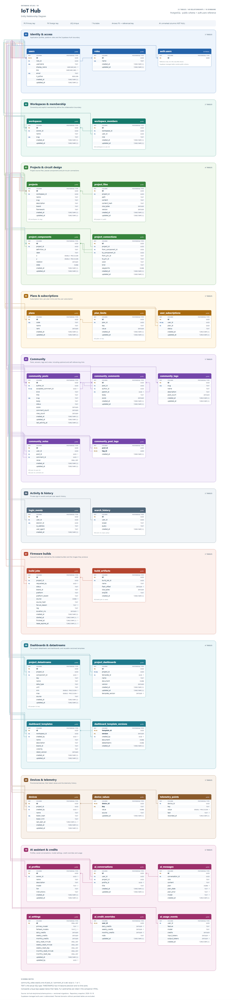

# Database

# Schema Overview

As of 2026-10-18: 33 public tables, 48 foreign keys, 19 migrations. RLS is enabled
on every public table. The rules this schema follows are in the sections after this
overview; per-migration decisions are in "Implemented Decisions".

## ER diagram

Full size: `docs/diagrams/iot-hub-erd.png`, vector `iot-hub-erd.svg` / `.pdf`, and an
interactive version with relationship highlighting in `iot-hub-erd.html`. It is
generated from `backend/prisma/schema.prisma` and checked against the migration
SQL; regenerate with the commands in `docs/diagrams/README.md`.

Sources of truth: `backend/prisma/schema.prisma` for the model and
`backend/prisma/migrations/` for the physical schema, RLS policies, triggers, and
grants. Nothing else defines schema.

## Tables and relationships

`auth.users` belongs to Supabase Auth. `users.id` is the same id, and a sign-up
trigger creates the profile row and a personal workspace.

| Domain | Tables | Key relationships |
| --- | --- | --- |
| Identity & access | `users`, `roles` | `users.id` → `auth.users.id`; `users.role_id` → `roles` (`admin` or `user`) |
| Workspaces | `workspaces`, `workspace_members` | A workspace has one owner and many members; `UNIQUE (workspace_id, user_id)`. Member role: `owner`, `admin`, `developer`, `editor`, `viewer` |
| Projects & circuit | `projects`, `project_files`, `project_components`, `project_connections` | A project belongs to one workspace. Files, placed parts, and pin-to-pin wires belong to the project; a connection references two components |
| Plans | `plans`, `plan_limits`, `user_subscriptions` | A plan has many limits (`UNIQUE (plan_id, key)`); a user has at most one subscription |
| Firmware builds | `build_jobs`, `build_artifacts` | A build job belongs to a project and the requesting user; artifacts belong to a job (`UNIQUE (build_job_id, name)`) |
| Dashboards | `project_datastreams`, `project_dashboards`, `dashboard_templates`, `dashboard_template_versions` | One dashboard per project. Datastreams belong to a project and optionally a component (`SET NULL`). Templates are workspace-owned with immutable versions |
| Devices & telemetry | `devices`, `device_values`, `telemetry_points` | A device belongs to a project. Latest value per `(device_id, key)`; history points per device |
| AI | `ai_profiles`, `ai_conversations`, `ai_messages`, `ai_settings`, `ai_credit_overrides`, `ai_usage_events` | A conversation belongs to one user and one project; messages belong to a conversation. `ai_settings` is a single row. Overrides and usage events belong to a user |
| Community | `community_posts`, `community_comments`, `community_tags`, `community_post_tags`, `community_votes` | Posts and comments have an author; comments may reply to a comment; a post may have one accepted comment. Votes target exactly one post or one comment |
| Activity | `login_events`, `search_history` | Per-user sign-in history (one row per session) and recent searches |

Delete behaviour: 36 foreign keys cascade, 8 set the reference to NULL, and the rest
restrict. Deleting a
user removes their workspaces, projects, community content, and history. Removing a
part keeps its datastreams with `component_id = NULL`. Per-table column notes are in
"Implemented Decisions" below.

## Indexes

Every index exists for a named query. Primary keys are omitted.

| Table | Index | Serves |
| --- | --- | --- |
| `users` | `UNIQUE username`, `UNIQUE email`, `role_id` | Sign-up availability, admin role lookup |
| `workspaces` | `UNIQUE slug`, `owner_id` | Workspace lookup, owner succession |
| `workspace_members` | `UNIQUE (workspace_id, user_id)`, `user_id` | Membership check on every request; "my workspaces" |
| `projects` | `UNIQUE (workspace_id, slug)`, `workspace_id` | Project list per workspace |
| `project_files` | `UNIQUE (project_id, path)`, `project_id` | File read/write by path; file list |
| `project_components` | `project_id` | Circuit load |
| `project_connections` | `project_id`, `from_component_id`, `to_component_id` | Circuit load; cascade on part removal |
| `plans`, `plan_limits` | `UNIQUE code`; `UNIQUE (plan_id, key)` | Entitlement lookup |
| `user_subscriptions` | `UNIQUE user_id`, `plan_id` | Current plan of a user |
| `build_jobs` | `(project_id, created_at DESC)`, `(requested_by, created_at)`, `(status, created_at)` | Build history; build minutes used; oldest queued job for the dispatcher |
| `build_artifacts` | `UNIQUE (build_job_id, name)` | Artifact download |
| `community_posts` | `UNIQUE slug`, `(created_at DESC, id DESC)`, `(score DESC, id DESC)`, `(last_activity_at DESC, id DESC)`, `author_id` | Cursor pagination for the newest, top, and active feeds |
| `community_comments` | `(post_id, created_at)`, `author_id`, `parent_id` | Thread load; replies |
| `community_votes` | `UNIQUE (user_id, post_id)`, `UNIQUE (user_id, comment_id)`, `post_id`, `comment_id` | One vote per user and target |
| `login_events` | `UNIQUE session_id`, `(user_id, created_at DESC)` | Idempotent recording; newest 50 |
| `search_history` | `UNIQUE (user_id, scope, query)`, `(user_id, scope, created_at DESC)` | De-duplicated newest 10 |
| `project_datastreams` | `UNIQUE (project_id, key)`, `component_id` | Widget binding; telemetry validation |
| `project_dashboards` | `UNIQUE project_id`, `template_id` | One dashboard per project |
| `dashboard_templates` | `(workspace_id, updated_at DESC)`, `created_by` | Template gallery |
| `ai_profiles` | `owner_id` | User and system profiles |
| `ai_conversations` | `(user_id, project_id, updated_at DESC)`, `project_id`, `profile_id` | Conversation list per project |
| `ai_messages` | `(conversation_id, created_at)` | Message history |
| `devices` | `UNIQUE token_hash`, `project_id`, `created_by` | Device-token authentication; device list |
| `telemetry_points` | `(device_id, key, recorded_at DESC)`, `recorded_at` | Chart series; 30-day retention delete |
| `ai_usage_events` | `(user_id, created_at DESC)`, `created_at` | Credit limit check; usage totals |

Do not add an index without a query that needs it. Thai text is not tokenized by
PostgreSQL's `simple` configuration, so community search uses `ILIKE` and has no
full-text index (see "Community tables").

---

## Primary Database

Use Supabase PostgreSQL.

Database structure must have one source of truth.

Use version-controlled migrations.

Do not manually modify production schema without a migration.

## ORM Strategy

The legacy system used Prisma.

Do not automatically preserve Prisma.

Evaluate:

* Supabase server SDK
* PostgreSQL driver/query builder
* Prisma

Document the selected approach in:

`docs/adr/ADR-001-database-access.md`

Prisma, if used, is backend-only.

## Schema Rules

Use constraints where appropriate:

* PRIMARY KEY
* FOREIGN KEY
* UNIQUE
* NOT NULL
* CHECK

Common resource fields may include:

* id
* created_at
* updated_at

Use revision/version only where optimistic concurrency is needed.

Do not automatically add soft deletion to every table.

## Workspace Model

Core relationship:

User
→ Workspace
→ Project
→ Device
→ Datastream
→ Dashboard

Workspace membership should be modeled explicitly.

Example roles:

* owner
* admin
* developer
* editor
* viewer

## Project Files

Do not store an entire project source tree as one large JSON document.

Use a structured project file model.

Example fields:

* id
* project_id
* path
* name
* content_reference
* content_hash
* size
* version
* created_at
* updated_at

Protect against:

* duplicate paths
* path traversal
* oversized files
* oversized projects

## Telemetry

PostgreSQL may initially store telemetry when traffic volume is manageable.

Typical fields:

* device_id
* timestamp
* metric
* value
* metadata

Common query index:

(device_id, timestamp)

Do not add indexes without query justification.

Keep telemetry access abstract enough to support future time-series storage.

## Query Rules

Avoid unbounded queries.

Avoid N+1 queries.

Avoid SELECT * when explicit contracts are preferable.

Use pagination.

Use cursor pagination for large collections when appropriate.

Use transactions for multi-step operations requiring atomicity.

## RLS

Use RLS for exposed sensitive resources.

Test policies for:

* ownership
* workspace membership
* viewer/editor roles
* private projects
* admin access

Every important RLS rule should have a corresponding security test.

RLS policies and table privileges must agree. Revoke broad defaults before granting
only the operations the client actually uses. This application keeps Data API access
read-only and routes writes through NestJS; do not rely on RLS alone to compensate for
an unnecessary `INSERT`, `UPDATE`, or `DELETE` grant. Internal trigger functions must
not retain PostgreSQL's default `EXECUTE` privilege for `PUBLIC`.

---

# Implemented Decisions

## ORM strategy

Resolved in `docs/adr/ADR-001-database-access.md`: **Prisma, backend-only**, with
Prisma Migrate as the single migration source of truth.

Rules that follow from that decision:

1. `prisma/schema.prisma` plus its migration history is the only schema source.
   The Supabase CLI must not be used to author `public` schema changes.
2. RLS policies, functions, and triggers are hand-written SQL inside Prisma
   migration files. A migration that adds a table needing a policy adds the policy
   in the same migration.
3. **Prisma must be scoped to the `public` schema.** Supabase owns `auth`, `storage`,
   and `realtime`. A `prisma migrate` run that can see those schemas will propose
   dropping them. This is the single most dangerous operational risk in the ORM
   decision — verify the scoping before the first migration against Supabase.
4. Prisma is backend-only and never reaches Angular.

## Repository layer

AI credit reset schedule (2026-10-11): migration
`20261011040000_ai_credit_reset_schedule` adds five non-null `smallint` columns to
`ai_settings`, with checks for minute-of-day (0–1439), Monday-based weekday (0–6),
and month day (1–28). Defaults preserve existing Bangkok reset boundaries. Existing
RLS and grants are unchanged. Apply this additive migration before deploying the
backend that reads the new columns; regenerate Prisma types from the schema.

Account profile details (2026-10-11): migration
`20261011010000_account_profile_details` adds nullable `users.display_name`
(`varchar(60)`) and `users.bio` (`varchar(280)`). Existing accounts and signup
triggers need no backfill. These presentation fields do not affect authorization;
the existing user RLS policies and read-only Data API privileges are unchanged.
Writes stay in the authenticated profile endpoint and `UserRepository.updateProfile`.

No business service touches Prisma. Services depend on abstract repository classes;
the Prisma implementations are bound in one module each:

| Contract | Implementation | Bound in |
| --- | --- | --- |
| `UserRepository` | `PrismaUserRepository` | `modules/users/users.module.ts` |
| `RoleRepository` | `PrismaRoleRepository` | `modules/users/users.module.ts` |
| `SessionRepository` | `PrismaSessionRepository` | `modules/auth/auth.module.ts` |

Repositories are domain-oriented, never `GenericRepository<T>`. An operation that
must be atomic is one repository method, so the transaction stays inside the
persistence layer — `UserRepository.changePassword` and
`UserRepository.updateForAdmin` both revoke sessions in the same transaction as the
write they accompany.

Changing the database technology means writing new implementations of those three
classes and editing the `useClass` bindings. No service, controller, or test changes.

## Current schema

Three tables — `roles`, `users`, `sessions` — from migration
`20260715082240_add_auth`. The workspace, project, device, datastream, and dashboard
model described above is not implemented yet; it arrives with Phase 2.

Known schema issues to address in the Phase 2 migration:

- `sessions.refresh_token` is `UNIQUE` on a bcrypt hash. Salting makes the
  constraint meaningless and it costs an index. Drop it additively.
- Expired and revoked sessions are never purged. Needs a retention job.
- No `updated_at` on `sessions`.

## Applied to Supabase (2026-08-28)

Three migrations applied to the Supabase Cloud project via the session pooler
(port 5432 — the transaction pooler on 6543 cannot run Prisma migrations).

Verified after applying:

- RLS enabled on `users`, `workspaces`, `workspace_members`, `roles`, with 8 policies.
- Triggers live on `auth.users`: `on_auth_user_created`, `on_auth_user_email_changed`.
- `users.id → auth.users.id` foreign key present, `users.password` gone.
- Roles `admin` and `user` seeded.
- Sign-up trigger tested end to end inside a rolled-back transaction: profile and
  personal workspace created with the member as `owner`, username derived from OAuth
  metadata, email change mirrored onto the profile.

### Defect found and fixed during that test

`workspaces.owner_id` was `ON DELETE RESTRICT` while `users.id` cascaded from
`auth.users`. Because the sign-up trigger gives every user a personal workspace,
**deleting any account failed** — from the API, the Supabase admin API, and the
dashboard alike.

Cascading workspaces would have been worse: a shared workspace would have been
destroyed along with its owner, taking other members' work with it.

Migration `20260828010000_workspace_owner_succession` adds a `BEFORE DELETE` trigger
on `public.users` that settles ownership first — handing each owned workspace to its
most senior remaining member, or deleting it when there is none. The `RESTRICT`
constraint stays as a safety net that should now never fire.

Both paths are covered by the rolled-back verification: a sole-member workspace is
removed with its owner; a shared workspace survives and its editor is promoted to
owner.

## Community tables (2026-09-22)

Migration `20260922000000_community` adds `community_tags`, `community_posts`,
`community_comments`, `community_post_tags`, and `community_votes`.

Three decisions worth knowing before touching them:

**Counters are denormalised and kept by triggers.** `community_posts.score`,
`community_posts.comment_count`, and `community_tags.post_count` are maintained
by `community_apply_vote_delta`, `community_apply_comment_delta`, and
`community_apply_tag_delta`. The feed sorts and paginates on those columns, so an
aggregate per row would make the first page a full scan of the vote table.
Keeping them in the API instead would leave them wrong on every path the API does
not run — a cascade delete when an account is removed, for one. **Nothing in the
repository layer may write these columns.**

**Votes are one table, not two.** `community_votes` carries a nullable `post_id`
and `comment_id` with a `num_nonnulls(...) = 1` check, so "which way did I vote"
is one lookup and the score trigger exists once. The unique pairs
`(user_id, post_id)` and `(user_id, comment_id)` do not collide because NULLs are
distinct in a unique index. Withdrawing a vote deletes the row; a stored `0`
would give "no opinion" two representations.

**Reads are public.** `community_posts`, `community_comments`,
`community_post_tags`, and `community_tags` grant `SELECT` to `anon` as well as
`authenticated`; posts are visible only while `status = 'published'`. Writes are
restricted to `author_id = auth.uid()`. `community_votes` is the exception: a
vote is private, only its aggregate is not, so only the voter can read their own
rows.

`community_posts.slug` is Unicode and carries a random suffix. Thai titles keep
their own letters — including vowel signs and tone marks, which are Unicode
*marks* rather than letters and would otherwise be stripped — and two posts
asking the same question get different URLs without a collision loop that would
leak how many exist.

Feed search is `ILIKE`, deliberately not full text. Postgres' `simple` search
configuration splits on whitespace and Thai is written without spaces between
words, so a tsvector index would never match a Thai query. Revisit with pgroonga
or pg_bigm when the table outgrows a sequential scan.

## Project activity timestamps (2026-09-25)

Migration `20260925000000_track_project_activity` defines `projects.updated_at`
as the latest persisted activity in the whole project. Row triggers on
`project_files`, `project_components`, and `project_connections` touch the parent
after inserts, updates, and deletes. The migration also backfills existing projects
from the latest child timestamp, so historical cards do not continue showing their
creation date.

The trigger is the source of truth because project content can be written through
several repositories and through database cascades. Application code must not try
to duplicate this timestamp maintenance.

## Sign-in and search history (2026-09-29)

Migration `20260929000000_login_and_search_history` adds `login_events` and
`search_history`. Both are private to NestJS: RLS is enabled with no policy and
nothing is granted to `anon` or `authenticated`. Rows cascade with `users`.

- `login_events` has one row per Supabase session (`session_id` is unique), so
  the client can report its session on every start without duplicates. Address
  and user agent are length-checked in the table as well as trimmed in the API.
- `search_history` is unique on `(user_id, scope, query)`: a repeated search
  updates `created_at` instead of inserting. The repository trims each scope to
  the newest 10 in the same transaction as the insert. `scope` is checked to
  `documents` or `community`.

Applied to Supabase on 2026-09-29 with `prisma migrate deploy`, together with the
two migrations still pending before it (`20260925000000_track_project_activity`
and `20260926000000_harden_data_api_privileges`). Afterwards both new tables showed
RLS enabled and no grants to `anon` or `authenticated`.

## Firmware build queue (2026-10-02)

Migration `20261002000000_build_jobs` adds `build_jobs` and `build_artifacts`
(ADR-002). Both are private to NestJS: RLS enabled, no policy, nothing granted to
`anon` or `authenticated`.

- `build_jobs` is the queue. The API inserts `queued`; the dispatcher claims the
  oldest with `UPDATE … WHERE id = (SELECT … FOR UPDATE SKIP LOCKED)` through the
  API, setting `lease_expires_at`. A queued job older than 15 minutes or a running
  job past its lease is marked `failed`/`timeout` lazily, on the next enqueue, claim,
  or status read.
- `source` (JSONB) is the snapshot of sources taken at request time, so autosave
  during a build cannot change what compiles. A CHECK clears it on every finished
  status; another caps it at 12 MiB.
- One active build per project is enforced by `pg_advisory_xact_lock` on the project
  id around the check-and-insert, not by a partial unique index, which Prisma would
  try to drop as drift.
- `requested_by` is `ON DELETE SET NULL`; build minutes per month are the sum of
  `duration_ms` by requester since the first of the month (UTC).
- `build_artifacts` holds images as `BYTEA` (≤ 8 MiB each, `size_bytes` checked
  against `octet_length`). Only the newest successful build of a project keeps
  images; finished history beyond 20 builds per project is deleted, both in the
  transaction that records a result. Rows cascade from `projects`.

Applied to Supabase on 2026-10-02 with `prisma migrate deploy` (the only pending
migration). Afterwards both tables showed RLS enabled, no policy, no grants to `anon`
or `authenticated`, and all ten CHECK constraints.

## Dashboards, datastreams, and templates (2026-10-10)

Migration `20261010000000_dashboards_and_templates`, additive only. Checked against a
throwaway Postgres, then applied to Supabase on 2026-10-10 with `prisma migrate deploy`
(the only pending migration). Afterwards all four tables showed RLS enabled, one SELECT
policy each, and only `SELECT` granted to `authenticated`; the security advisor raised
nothing new.

| Table | Holds |
| --- | --- |
| `project_datastreams` | Named values a widget binds to. `UNIQUE (project_id, key)`. `component_id` is `SET NULL` when the part is removed, so a widget's data source is not silently deleted with it. |
| `project_dashboards` | One document per project (`UNIQUE project_id`) with `version` for optimistic concurrency, and the template and template version it was made from. |
| `dashboard_templates` | Workspace-owned reusable dashboards; `visibility` is `private` (creator) or `workspace` (every member). |
| `dashboard_template_versions` | Immutable revisions, `PRIMARY KEY (template_id, version)`. Editing a template adds a version. |

A dashboard is a JSONB document rather than a row per widget: a layout is edited and
saved as a whole, and one version guards the whole. Every document is rebuilt by
`parseDashboardDocument` (`modules/dashboards/dashboard-document.ts`) before it is
stored; CHECK constraints bound its size and shape as a second line.

RLS: members read their projects' datastreams and dashboards; template reads follow
visibility. The Data API is read-only for all four tables, as in
`20260926000000_harden_data_api_privileges`; writes go through NestJS.

## AI profiles and conversations (2026-10-11)

Migration `20261011000000_ai_profiles_and_conversations`, additive only (ADR-007).
Checked against a throwaway Postgres, then applied to Supabase on 2026-10-11 with `prisma migrate deploy`, together with `20261011010000_account_profile_details`. Afterwards all three tables showed RLS enabled, one SELECT policy each, and only `SELECT` granted to `authenticated`, and the security advisor raised nothing new. The throwaway check covered the constraints, the cascades
(deleting a project removes its conversations and messages; deleting a profile leaves its
conversations with `profile_id` NULL), RLS, and the grants.

| Table | Holds |
| --- | --- |
| `ai_profiles` | Model, `tier` (`auto`/`balanced`/`deep`), and instructions (max 4000 characters). `owner_id` NULL marks a system profile that admins manage and every user may choose. |
| `ai_conversations` | One chat, owned by one user (`user_id`) and tied to one project (`project_id`, cascade). Indexed on `(user_id, project_id, updated_at DESC)` for the list. |
| `ai_messages` | Turns. `role` is `user` or `assistant`. An assistant turn may carry the `plan` JSONB it proposed and its `plan_state`. The plan is capped at 2 MB and the content at 50,000 characters. |

RLS: a user reads system profiles and their own, and their own conversations and
messages, but only while they still have `viewer` on the project. The Data API is
read-only for all three tables; writes go through NestJS.

## Devices and telemetry (2026-10-11)

Migration `20261011020000_devices_and_telemetry`, additive only (ADR-008). It was checked
against a throwaway Postgres (the constraints, the cascade from project to devices to values
and points, and the column grants), then applied to Supabase on 2026-10-11 with
`prisma migrate deploy`. Afterwards all three tables showed RLS enabled with one policy each,
`token_hash` was not granted to `authenticated`, and the security advisor raised nothing new.

| Table | Holds |
| --- | --- |
| `devices` | A board in a project. `token_hash` is the SHA-256 of its token (unique, 64 hex characters) and is **not granted** to the Data API. `token_hint` holds the last four characters of the token. |
| `device_values` | The latest value per `(device_id, key)`, a JSONB number, boolean, or string of at most 1 KB. `source` is `device` or `app`. |
| `telemetry_points` | History. Each point has exactly one of `value` (a number, or a boolean as 0 or 1) or `text` (at most 256 characters). Indexed on `(device_id, key, recorded_at DESC)` for charts and on `recorded_at` for the 30-day retention. |

RLS: project viewers read all three tables. Writes go through NestJS only.

## AI settings and credits (2026-10-11)

Migration `20261011030000_ai_settings_and_credits`, additive only (ADR-009). It was checked
against a throwaway Postgres (the single-row and limit constraints, the cascade from users,
and the top-users aggregate), then applied to Supabase on 2026-10-11. Afterwards RLS was
enabled on all three tables; only `ai_usage_events` has a policy and a Data API grant. The
advisor's new findings are the INFO-level "RLS enabled, no policy" on `ai_settings` and
`ai_credit_overrides`, which is intended: both are closed to the Data API, like `build_jobs`.

| Table | Holds |
| --- | --- |
| `ai_settings` | One row (`CHECK id = 1`). `primary_model`, up to five `fallback_models`, and the default `daily`/`weekly`/`monthly` credits (-1 = unlimited). It is seeded with no model and unlimited credits, so behaviour is unchanged until an admin edits it. |
| `ai_credit_overrides` | One row per user who has custom limits. NULL keeps the default and -1 is unlimited. Cascades with the user. |
| `ai_usage_events` | One row per answered AI request: `feature` (`project`/`advisor`), model, credits, and tokens. Indexed on `(user_id, created_at DESC)` for the limit check and on `created_at` for the totals. |

RLS: users may read their own usage events. Settings and overrides are not readable through
the Data API. All writes go through NestJS.
