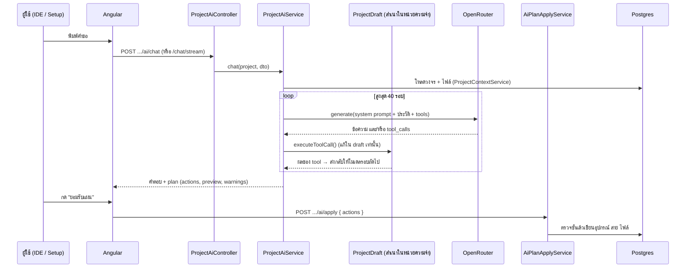

# 04 · ถาม AI หรือสั่งให้ AI ทำงาน

ระบบมี AI 3 ตัวที่ใช้ provider ชุดเดียวกัน ([`ai.module.ts:22–56`](../backend/src/modules/ai/ai.module.ts#L22)):

| ตัว | Endpoint | ใช้ทำอะไร |
| --- | --- | --- |
| Project assistant | `POST /api/workspaces/:w/projects/:p/ai/chat`, `/chat/stream`, `/apply` | ทำงานในโปรเจกต์: เพิ่มอุปกรณ์ ต่อสาย แก้โค้ด |
| IoT advisor | `POST /api/ai/advisor/chat` | ตอบคำถาม IoT ทั่วไป วิเคราะห์ error log (หน้า `/user/assistant`) |
| Admin assistant | `POST /api/admin/ai/chat` | ช่วยแอดมินวิเคราะห์ระบบ |

เอกสารนี้เน้น **Project assistant** ซึ่งซับซ้อนที่สุด

## ภาพรวม



จุดสำคัญ: ระหว่างคุยกับโมเดล **ยังไม่มีอะไรถูกเขียนลงฐานข้อมูล** ทุก tool แก้แค่ `ProjectDraft` ในหน่วยความจำ
ของจริงเปลี่ยนตอน `/apply` เท่านั้น

## 1. Frontend ส่งคำขอ

| โค้ด | ทำอะไร |
| --- | --- |
| [`project-workspace.page.ts:946`](../frontend/src/app/features/user/workspace/project-workspace.page.ts#L946) | ปุ่มส่งในแชตของ IDE เรียก `chat.send(...)` |
| [`project-ai-chat.store.ts:137`](../frontend/src/app/features/user/workspace/project-ai-chat.store.ts#L137) | `send()` รวมประวัติแชต (ตัดข้อความทักทายออก) ส่ง `profile: 'balanced'`, `activeFile`, `diagnostics` |
| [`project-ai.service.ts:28`](../frontend/src/app/features/user/workspace/project-ai.service.ts#L28) | `chat()` → `POST .../ai/chat` รอคำตอบทีเดียว |
| [`project-ai.service.ts:45`](../frontend/src/app/features/user/workspace/project-ai.service.ts#L45) | `chatStream()` → `POST .../ai/chat/stream` อ่าน NDJSON ทีละบรรทัด (`progress` / `result` / `error`) ใช้ในหน้า setup |
| [`project-ai-chat.store.ts:194`](../frontend/src/app/features/user/workspace/project-ai-chat.store.ts#L194) | `applyPlan()` เมื่อผู้ใช้กดยอมรับ → `api.apply()` |
| [`project-ai.service.ts:95`](../frontend/src/app/features/user/workspace/project-ai.service.ts#L95) | `apply()` → `POST .../ai/apply` |

## 2. Controller

[`project-ai.controller.ts`](../backend/src/modules/ai/project/project-ai.controller.ts)

- บรรทัด 56 `chat()`: ตรวจสิทธิ์ `viewer` แล้วเรียก `assistant.chat()` (82)
- บรรทัด 97 `chatStream()`: ตั้ง header `application/x-ndjson` และ `X-Accel-Buffering: no` เพื่อไม่ให้ nginx กักข้อมูลไว้
  - ส่งบรรทัด `{type:'progress'}` ทุกครั้งที่ AI ทำงานแต่ละขั้น และ `{type:'result'}` ตอนจบ (135–141)
  - ถ้าผู้ใช้ปิดแท็บ จะ abort งานทันที (115–119)
- บรรทัด 157 `apply()`: ตรวจสิทธิ์ `editor` (สูงกว่า chat) แล้วเรียก `plans.apply()`

## 3. ProjectAiService — หัวใจของ AI

[`project-ai.service.ts`](../backend/src/modules/ai/project/project-ai.service.ts)

### `chat()` บรรทัด 196
ห่อ `generatePlan()` ด้วยเวลาจำกัด 20 นาที (`GENERATION_TIMEOUT_MS` บรรทัด 75) และรองรับการยกเลิกจาก client

### `generatePlan()` บรรทัด 242

| บรรทัด | ขั้นตอน |
| --- | --- |
| 249–252 | โหลด context ของโปรเจกต์ (วงจร + ไฟล์ทั้งหมด) และ catalog ของโมเดลพร้อมกัน |
| 254–258 | สร้าง `ProjectDraft` สำเนาของวงจรและไฟล์ที่ AI จะแก้ |
| 260–276 | เลือก profile (`fast` ถูกยกขึ้นเป็น `balanced` เพราะงานโปรเจกต์ต้องเรียก tool หลายรอบ) |
| 278–281 | เลือกโมเดล: ถ้าผู้ใช้เลือกเองใช้ตัวนั้น ไม่งั้นจัดอันดับจาก catalog ได้สูงสุด 3 ตัว (ตัวแรกหลัก ที่เหลือเป็น fallback) |
| 287 | ถ้าโมเดลรองรับ tool จะให้ `PROJECT_TOOLS` ถ้าไม่รองรับจะตอบได้อย่างเดียว แก้อะไรไม่ได้ |
| 288–297 | ประกอบ system prompt = `SYSTEM_PROMPT` (บรรทัด 90) + context ของโปรเจกต์ (`context.render`) + ปัญหาของวงจร (`renderProblems`) |
| 304–332 | **prefetch**: รัน `get_board_pinout` และ `read_source_file` ให้ก่อน โมเดลจึงเห็น pinout และโค้ดตั้งแต่รอบแรก |
| 352 | **tool loop** สูงสุด `MAX_TOOL_ROUNDS = 40` รอบ (บรรทัด 51) |
| 363 | `provider.generate({ model, fallbackModels, systemPrompt, messages, tools })` → OpenRouter |
| 385–389 | ถ้าโมเดลไม่ขอ tool แล้ว = จบ |
| 397–427 | รันทุก tool ที่ขอด้วย `executeToolCall(draft, call)` แล้วใส่ผลกลับเข้า `turns` เป็น role `tool` |
| 412–417 | ถ้า tool ถูกปฏิเสธซ้ำด้วยคำสั่งเดิม จะเตือนโมเดลว่ากำลังวนลูป |
| 444–446 | `draft.alignRails()` จัดสาย GND/VCC และ `draft.actions()` ดึงรายการ action ออกมาเป็นแผน |
| 448–470 | ส่งกลับ `{ content, plan: { actions, preview, warnings }, model, usage }` |

### Tools ที่ AI เรียกได้

นิยามอยู่ที่ [`ai-tools.ts`](../backend/src/modules/ai/project/ai-tools.ts) และตัวรันอยู่ที่ [`ai-tool-executor.ts:58`](../backend/src/modules/ai/project/ai-tool-executor.ts#L58)

| Tool | ประเภท | ฟังก์ชันใน executor |
| --- | --- | --- |
| `get_board_pinout` | อ่าน | `boardPinout` (118) |
| `get_device_pinout` | อ่าน | `devicePinout` (149) |
| `read_source_file` | อ่าน | `readFile` (193) |
| `get_project_problems` | อ่าน | `draft.problems()` (82) |
| `search_device_catalog` | อ่าน | `searchCatalog` (215) |
| `read_device_datasheet` | อ่าน | `readDatasheet` (249) |
| `add_device` | เขียน (draft) | `addDevice` (313) |
| `configure_device` | เขียน | `configureDevice` (291) |
| `wire_to_board` | เขียน | `wireToBoard` (409) |
| `connect_pins` | เขียน | `connectPins` (448) |
| `disconnect_pins` | เขียน | `disconnectPins` (490) |
| `write_source_file` | เขียน | `writeFile` (508) |

กติกาที่บังคับในโค้ด (ไม่ใช่แค่ใน prompt):

- ต้องอ่าน datasheet ก่อนเพิ่มหรือต่อสายอุปกรณ์ที่มีเอกสาร (`requireDatasheetReview` บรรทัด 557)
- argument ทุกตัวถูกตรวจใหม่ ถึง JSON Schema จะตรวจแล้วก็ตาม (`requireString` 588)
- รอบสุดท้ายจะถอด tool เขียนออก เหลือแต่ tool อ่าน (บรรทัด 357–360)

### `ProjectDraft`

[`project-draft.ts:87`](../backend/src/modules/ai/project/project-draft.ts#L87) เก็บวงจรและไฟล์ฉบับร่าง
`addDevice` (258), `configure` (308), `connect` (337), `wireToBoard` (381), `disconnect` (411), `writeFile` (464)
ทุกการแก้จะถูกจดเป็น action แล้วดึงออกด้วย `actions()` (228)

## 4. Apply แผน

[`ai-plan-apply.service.ts:58`](../backend/src/modules/ai/project/ai-plan-apply.service.ts#L58) `apply()`

1. โหลดวงจรปัจจุบันจาก DB
2. ตรวจทุก action ว่ายังใช้ได้ เช่น สายที่อ้างอุปกรณ์ที่แผนไม่ได้สร้าง หรืออุปกรณ์ที่ถูกลบไปแล้ว → ตอบ `stale`
3. เขียนผ่าน service เดียวกับที่ canvas ใช้ (`ProjectComponentsService`, `ProjectConnectionsService`, `ProjectFilesService`) โควตาและการตรวจสิทธิ์จึงอยู่ทางเดียว
4. ถ้าล้มกลางทาง `rollback()` (278) ลบอุปกรณ์และสายที่เพิ่งสร้าง ไฟล์เขียนเป็นอย่างสุดท้ายเพราะย้อนกลับไม่ได้
5. ส่งกลับ `{ componentsAdded, createdComponentIds, connectionsAdded, connectionsRemoved, filesWritten }`

## 5. Context ที่ AI เห็น

[`project-context.service.ts:55`](../backend/src/modules/ai/project/project-context.service.ts#L55) `build()` โหลดวงจร (`circuits.load`) และเนื้อหาไฟล์ทุกไฟล์
`render()` (96) แปลงเป็นข้อความต่อท้าย system prompt: บอร์ด อุปกรณ์ สายที่ต่ออยู่ และไฟล์

## โค้ดจริง

โค้ดด้านล่างคัดลอกจากไฟล์จริงตามเลขบรรทัดที่ระบุ ตัด comment ออกแล้ว ส่วนอื่นไม่ได้แก้

### แชตใน IDE: send()

[`project-ai-chat.store.ts:137–180`](../frontend/src/app/features/user/workspace/project-ai-chat.store.ts#L137)

```ts
  async send(context: TurnContext): Promise<void> {
    const text = this.prompt().trim();
    if (!text || this.sending()) return;

    this.messages.update((messages) => [...messages, { id: Date.now(), role: 'user', text }]);
    this.syncActiveSession();
    this.prompt.set('');
    this.sending.set(true);

    try {
      const history = this.messages()
        .slice(1)
        .map((message) => ({ role: message.role, content: message.text }));

      const response = await this.api.chat(context.projectId, {
        profile: 'balanced',
        messages: history,
        ...(context.activeFile ? { activeFile: context.activeFile } : {}),
        ...(context.diagnostics ? { diagnostics: context.diagnostics } : {}),
      });

      this.messages.update((messages) => [
        ...messages,
        {
          id: Date.now() + 1,
          role: 'assistant',
          text: response.content,
          ...(response.plan?.actions.length
            ? { plan: response.plan, planState: 'pending' as const }
            : {}),
        },
      ]);
    } catch (error: unknown) {
      this.messages.update((messages) => [
        ...messages,
        { id: Date.now() + 1, role: 'assistant', text: this.errorText(error) },
      ]);
    } finally {
      this.sending.set(false);
      this.syncActiveSession();
    }
  }
```

### แชตใน IDE: applyPlan()

[`project-ai-chat.store.ts:194–219`](../frontend/src/app/features/user/workspace/project-ai-chat.store.ts#L194)

```ts
  async applyPlan(projectId: string, messageId: number): Promise<ApplyPlanResult | null> {
    const message = this.messages().find((item) => item.id === messageId);
    if (!message?.plan || message.planState === 'applying') return null;

    this.patchMessage(messageId, { planState: 'applying', planError: undefined });

    try {
      const result = await this.api.apply(projectId, message.plan.actions);
      this.patchMessage(messageId, { planState: 'applied' });
      if (result.filesWritten.length) this.files.forget(projectId);
      await this.canvas.arrangeNew(projectId, result.createdComponentIds ?? []).catch(() => undefined);
      this.canvasSnapshots.forget(projectId);
      return result;
    } catch (error: unknown) {
      this.patchMessage(messageId, {
        planState: 'failed',
        planError: this.errorText(error),
      });
      return null;
    } finally {
      this.syncActiveSession();
    }
  }
```

### Client อ่าน stream แบบ NDJSON และ apply

[`project-ai.service.ts:45–92`](../frontend/src/app/features/user/workspace/project-ai.service.ts#L45)

```ts
  async chatStream(
    projectId: string,
    request: ProjectAiChatRequest,
    onProgress: (event: AiProgressEvent) => void,
    signal?: AbortSignal,
  ): Promise<ProjectAiChatResponse> {
    const workspaceId = await this.requireWorkspaceId();
    let consumed = 0;
    let outcome: StreamOutcome | null = null;

    const readLines = (text: string) => {
      const end = text.lastIndexOf(NEWLINE);
      if (end < consumed) return;
      const lines = text.slice(consumed, end).split(NEWLINE);
      consumed = end + 1;
      for (const line of lines) {
        const message = parseStreamLine(line);
        if (!message) continue;
        if (message.type === 'progress')
          onProgress({ stage: message.stage, detail: message.detail, status: message.status });
        else outcome = message;
      }
    };

    const response = await lastValueFrom(
      this.http
        .post(`${this.baseUrl(workspaceId, projectId)}/chat/stream`, request, {
          observe: 'events',
          reportProgress: true,
          responseType: 'text',
        })
        .pipe(
          tap((event) => {
            if (event.type === HttpEventType.DownloadProgress) {
              readLines((event as HttpDownloadProgressEvent).partialText ?? '');
            }
          }),
          takeUntil(signal ? fromEvent(signal, 'abort') : NEVER),
        ),
    );
    if (response.type === HttpEventType.Response) readLines(`${response.body ?? ''}${NEWLINE}`);

    const settled = outcome as StreamOutcome | null;
    if (!settled) throw new Error('AI ตอบกลับไม่ครบ กรุณาลองใหม่อีกครั้ง');
    if (settled.type === 'error') throw new Error(settled.error.message);
    return settled.result;
  }
```

[`project-ai.service.ts:95–100`](../frontend/src/app/features/user/workspace/project-ai.service.ts#L95)

```ts
  async apply(projectId: string, actions: readonly AiPlanAction[]): Promise<ApplyPlanResult> {
    const workspaceId = await this.requireWorkspaceId();
    return firstValueFrom(
      this.http.post<ApplyPlanResult>(`${this.baseUrl(workspaceId, projectId)}/apply`, { actions }),
    );
  }
```

### Controller: chat / chat/stream / apply

[`project-ai.controller.ts:56–86`](../backend/src/modules/ai/project/project-ai.controller.ts#L56)

```ts
  @Post('chat')
  async chat(
    @Req() request: AuthenticatedRequest,
    @Param('workspaceId', ParseUUIDPipe) workspaceId: string,
    @Param('projectId', ParseUUIDPipe) projectId: string,
    @Body() body: ProjectChatDto,
    @Res({ passthrough: true }) response: Response,
  ) {
    await this.authorization.requireWorkspaceRole(
      request.user.id,
      workspaceId,
      'viewer',
    );
    const project = await this.projects.requireInWorkspace(
      workspaceId,
      projectId,
    );

    const controller = new AbortController();
    const cancel = () => {
      if (!response.writableEnded) controller.abort();
    };
    response.once('close', cancel);

    try {
      return await this.assistant.chat(project, body, controller.signal);
    } finally {
      response.off('close', cancel);
    }
  }
```

[`project-ai.controller.ts:97–154`](../backend/src/modules/ai/project/project-ai.controller.ts#L97)

```ts
  @Post('chat/stream')
  async chatStream(
    @Req() request: AuthenticatedRequest,
    @Param('workspaceId', ParseUUIDPipe) workspaceId: string,
    @Param('projectId', ParseUUIDPipe) projectId: string,
    @Body() body: ProjectChatDto,
    @Res() response: Response,
  ): Promise<void> {
    await this.authorization.requireWorkspaceRole(
      request.user.id,
      workspaceId,
      'viewer',
    );
    const project = await this.projects.requireInWorkspace(
      workspaceId,
      projectId,
    );

    const controller = new AbortController();
    const cancel = () => {
      if (!response.writableEnded) controller.abort();
    };
    response.once('close', cancel);

    response.status(200);
    response.setHeader('Content-Type', 'application/x-ndjson; charset=utf-8');
    response.setHeader('Cache-Control', 'no-cache, no-transform');
    response.setHeader('X-Accel-Buffering', 'no');
    response.flushHeaders();

    const send = (line: object) => {
      if (!response.writableEnded)
        response.write(`${JSON.stringify(line)}
`);
    };

    try {
      const result = await this.assistant.chat(
        project,
        body,
        controller.signal,
        (event) => send({ type: 'progress', ...event }),
      );
      send({ type: 'result', result });
    } catch (error) {
      send({ type: 'error', error: streamError(error) });
      if (!(error instanceof HttpException)) {
        this.logger.error(
          'Streamed AI turn failed',
          error instanceof Error ? error.stack : String(error),
        );
      }
    } finally {
      response.off('close', cancel);
      response.end();
    }
  }
```

[`project-ai.controller.ts:157–175`](../backend/src/modules/ai/project/project-ai.controller.ts#L157)

```ts
  @Post('apply')
  async apply(
    @Req() request: AuthenticatedRequest,
    @Param('workspaceId', ParseUUIDPipe) workspaceId: string,
    @Param('projectId', ParseUUIDPipe) projectId: string,
    @Body() body: ApplyPlanDto,
  ) {
    await this.authorization.requireWorkspaceRole(
      request.user.id,
      workspaceId,
      'editor',
    );
    const project = await this.projects.requireInWorkspace(
      workspaceId,
      projectId,
    );

    return this.plans.apply(request.user.id, project, body.actions);
  }
```

### ProjectAiService.chat(): จำกัดเวลาและการยกเลิก

[`project-ai.service.ts:196–240`](../backend/src/modules/ai/project/project-ai.service.ts#L196)

```ts
  async chat(
    project: Project,
    dto: ProjectChatDto,
    signal?: AbortSignal,
    onProgress: AiProgressListener = () => {},
  ): Promise<ProjectChatResult> {
    const deadline = new AbortController();
    const combined = signal
      ? AbortSignal.any([signal, deadline.signal])
      : deadline.signal;
    let onAbort: () => void = () => {};
    const interrupted = new Promise<never>((_resolve, reject) => {
      onAbort = () =>
        reject(
          deadline.signal.aborted
            ? new ServiceUnavailableException({
                code: 'AI_GENERATION_TIMEOUT',
                message:
                  'AI ใช้เวลาเกิน 20 นาที จึงหยุดคำขอนี้ ยังไม่มีการใช้แผนกับโปรเจกต์ กรุณาลองใหม่ภายหลัง',
              })
            :
              new HttpException(
                {
                  code: 'AI_GENERATION_CANCELLED',
                  message: 'หยุดคำขอ AI แล้ว ยังไม่มีการใช้แผนกับโปรเจกต์',
                },
                CLIENT_CLOSED_REQUEST,
              ),
        );
      if (combined.aborted) onAbort();
      else combined.addEventListener('abort', onAbort, { once: true });
    });
    const timer = setTimeout(() => deadline.abort(), GENERATION_TIMEOUT_MS);
    try {
      return await Promise.race([
        interrupted,
        this.generatePlan(project, dto, combined, onProgress),
      ]);
    } finally {
      clearTimeout(timer);
      combined.removeEventListener('abort', onAbort);
    }
  }
```

### ProjectAiService.generatePlan(): เลือกโมเดล, prompt, tool loop, สร้างแผน

[`project-ai.service.ts:242–471`](../backend/src/modules/ai/project/project-ai.service.ts#L242)

```ts
  private async generatePlan(
    project: Project,
    dto: ProjectChatDto,
    signal: AbortSignal,
    onProgress: AiProgressListener,
  ): Promise<ProjectChatResult> {
    signal.throwIfAborted();
    const [context, { models }] = await Promise.all([
      this.context.build(project, dto.activeFile ?? null),
      this.catalog.load(),
    ]);
    signal.throwIfAborted();
    const draft = new ProjectDraft(
      context.circuit,
      context.fileContents,
      dto.diagnostics,
    );

    const requestedProfile = dto.profile ?? AiTaskProfile.Auto;
    const resolvedProfile =
      requestedProfile === AiTaskProfile.Auto
        ? this.selector.inferProfile(dto.messages)
        : requestedProfile;
    const profile =
      resolvedProfile === AiTaskProfile.Fast
        ? AiTaskProfile.Balanced
        : resolvedProfile;

    const override = dto.model?.trim();
    const candidates = override
      ? [this.resolveOverride(models, override)]
      : this.withPinnedModel(models, this.resolveByProfile(models, profile));
    const chosen = candidates[0];

    const tools = chosen.supportsTools ? PROJECT_TOOLS : [];
    const systemPrompt = [
      SYSTEM_PROMPT,
      chosen.supportsTools
        ? ''
        : '\nYou have no tools in this turn. You may explain the project from the context, but you must not state a GPIO number that is not already listed in the connections, and you cannot change anything.',
      '\n---\n',
      this.context.render(context),
      '\n',
      renderProblems(context.circuit, dto.diagnostics),
    ].join('\n');

    const turns: AiConversationTurn[] = dto.messages.map((message) => ({
      role: message.role,
      content: message.content,
    }));

    if (chosen.supportsTools) {
      const initialReads: AiToolCall[] = [
        {
          id: `prefetch-${randomUUID()}`,
          name: 'get_board_pinout',
          rawArguments: '{}',
        },
        ...(context.activeFile
          ? [
              {
                id: `prefetch-${randomUUID()}`,
                name: 'read_source_file',
                rawArguments: JSON.stringify({ path: context.activeFile }),
              },
            ]
          : []),
      ];
      turns.push({ role: 'assistant', content: '', toolCalls: initialReads });
      for (const call of initialReads) {
        turns.push({
          role: 'tool',
          toolCallId: call.id,
          name: call.name,
          content: executeToolCall(draft, call).content,
        });
      }
    }

    const maxOutputTokens = Math.min(
      Number(this.config.get<string>('AI_MAX_OUTPUT_TOKENS')) ||
        DEFAULT_MAX_OUTPUT_TOKENS,
      ...candidates.map(
        (model) => model.maxCompletionTokens ?? DEFAULT_MAX_OUTPUT_TOKENS,
      ),
    );

    let content = '';
    let usage: ProjectChatResult['usage'];
    let servedModel = chosen.id;
    let activeModel = chosen.id;
    const refusals: ToolRefusal[] = [];
    const refusedCalls = new Set<string>();
    let completed = false;

    for (let round = 0; round <= MAX_TOOL_ROUNDS; round++) {
      signal.throwIfAborted();
      const roundTools =
        round === MAX_TOOL_ROUNDS
          ? tools.filter((tool) => READ_TOOLS.includes(tool))
          : tools;

      onProgress({ stage: 'thinking' });
      const result = await this.provider.generate({
        model: activeModel,
        fallbackModels: candidates
          .map((model) => model.id)
          .filter((id) => id !== activeModel),
        systemPrompt,
        messages: compactHistory(turns),
        maxOutputTokens,
        ...(roundTools.length ? { tools: [...roundTools] } : {}),
        signal,
      });
      signal.throwIfAborted();

      servedModel = result.servedModel ?? servedModel;
      if (candidates.some((model) => model.id === servedModel)) {
        activeModel = servedModel;
      }
      usage = result.usage ?? usage;
      content = result.content || content;

      const calls = result.toolCalls ?? [];
      if (!calls.length) {
        completed = true;
        break;
      }

      turns.push({
        role: 'assistant',
        content: result.content,
        toolCalls: calls,
      });

      for (const call of calls) {
        const progress = progressOf(call, (id) => draft.labelOf(id));
        onProgress({ ...progress, status: 'pending' });
        const outcome = roundTools.some((tool) => tool.name === call.name)
          ? executeToolCall(draft, call)
          : {
              ok: false,
              content: `Tool "${call.name}" is not available in this round. Finish your response.`,
            };
        onProgress(progressResult(progress, outcome));
        let content =
          result.truncated &&
          !outcome.ok &&
          /not valid JSON/.test(outcome.content)
            ? TRUNCATED_CALL
            : outcome.content;
        if (!outcome.ok) {
          refusals.push({ call, message: outcome.content });
          const signature = `${call.name}:${call.rawArguments}`;
          if (refusedCalls.has(signature)) content += REPEATED_REFUSAL;
          refusedCalls.add(signature);
        }

        turns.push({
          role: 'tool',
          toolCallId: call.id,
          name: call.name,
          content: content,
        });
      }

      if (round === MAX_TOOL_ROUNDS) {
        this.logger.warn(
          `Project ${project.id}: tool loop hit ${MAX_TOOL_ROUNDS} rounds`,
        );
      }
    }

    if (!completed) {
      throw new ServiceUnavailableException({
        code: 'AI_GENERATION_INCOMPLETE',
        message:
          'AI ยังสร้างแผนไม่เสร็จภายในจำนวนขั้นตอนที่กำหนด ยังไม่มีการเปลี่ยนแปลงโปรเจกต์ กรุณาลองแบ่งคำขอเป็นส่วนย่อย',
      });
    }

    draft.alignRails();
    const actions = draft.actions();
    if (actions.length) assertPlanIsCoherent(actions);

    return {
      id: randomUUID(),
      model: servedModel,
      vendor:
        models.find((model) => model.id === servedModel)?.vendor ??
        chosen.vendor,
      profile: requestedProfile,
      autoSelected: !override,
      content:
        content ||
        'ผมยังไม่ได้ข้อสรุปสำหรับคำขอนี้ ลองอธิบายเพิ่มอีกนิดได้ไหมครับ',
      createdAt: new Date().toISOString(),
      ...(actions.length
        ? {
            plan: {
              actions: [...actions],
              preview: previewOf(actions, (id) => draft.labelOf(id)),
              warnings: userFacingWarnings(refusals, draft),
            },
          }
        : {}),
      usage,
    };
  }
```

### ตัวอย่างนิยาม tool (add_device)

[`ai-tools.ts:100–142`](../backend/src/modules/ai/project/ai-tools.ts#L100)

```ts
  {
    name: 'add_device',
    description:
      'Stage adding a component to the project after read_device_datasheet has been called for its definition in this turn. If the project already contains one of this definition it is reused and nothing is added, unless the user explicitly asked for an additional unit. Only call this when the user asked for hardware the project does not have.',
    parameters: {
      type: 'object',
      properties: {
        definitionId: {
          type: 'string',
          description:
            'Catalog id, e.g. dht22, oled-096-i2c. Confirm it with search_device_catalog first.',
        },
        label: {
          type: 'string',
          description: 'Optional name shown on the canvas. Give separate units distinct labels, e.g. RGB LED 1 and RGB LED 2. Retrying the same definition and label reuses that unit, including when allowDuplicate is true.',
        },
        settings: {
          type: 'object',
          additionalProperties: { type: ['string', 'number', 'boolean'] },
          description:
            'Optional part settings by id, e.g. {"color": "green"} for an LED or {"trigger": "high"} for a relay. The allowed ids and values are listed under "settings" in search_device_catalog and the pinout. Set them whenever the request names one — a green status LED is an LED with color green.',
        },
        allowDuplicate: {
          type: 'boolean',
          description:
            'True only when the user asked for an ADDITIONAL unit of a part the project already has.',
        },
        wirePins: {
          type: 'array',
          items: { type: 'string' },
          minItems: 1,
          maxItems: 16,
          description:
            'Optional component pin names confirmed by search_device_catalog, e.g. ["DATA", "VCC", "GND"]. Each name may appear only once. Add/reuse and wire these to legal board pins in one call. The result includes the pinout and assigned GPIO numbers. For bare LEDs/resistors use connect_pins instead.',
        },
      },
      required: ['definitionId'],
      additionalProperties: false,
    },
  },
```

### รัน tool ตามชื่อ

[`ai-tool-executor.ts:58–110`](../backend/src/modules/ai/project/ai-tool-executor.ts#L58)

```ts
export function executeToolCall(
  draft: ProjectDraft,
  call: AiToolCall,
): ToolOutcome {
  let args: Record<string, unknown>;
  try {
    const parsed: unknown = JSON.parse(call.rawArguments);
    if (!parsed || typeof parsed !== 'object' || Array.isArray(parsed)) {
      return refuse('Arguments must be a JSON object.');
    }
    args = parsed as Record<string, unknown>;
  } catch {
    return refuse('Arguments were not valid JSON. Send a JSON object.');
  }

  try {
    switch (call.name) {
      case 'get_board_pinout':
        return boardPinout(draft);
      case 'get_device_pinout':
        return devicePinout(draft, args);
      case 'read_source_file':
        return readFile(draft, args);
      case 'get_project_problems':
        return ok(draft.problems());
      case 'search_device_catalog':
        return searchCatalog(args);
      case 'read_device_datasheet':
        return readDatasheet(draft, args);
      case 'add_device':
        return addDevice(draft, args);
      case 'configure_device':
        return configureDevice(draft, args);
      case 'wire_to_board':
        return wireToBoard(draft, args);
      case 'connect_pins':
        return connectPins(draft, args);
      case 'disconnect_pins':
        return disconnectPins(draft, args);
      case 'write_source_file':
        return writeFile(draft, args);
      default:
        return refuse(`Unknown tool "${call.name}".`);
    }
  } catch (error) {
    if (error instanceof WiringError) {
      return refuse(`${error.code}: ${error.message}`);
    }
    return refuse(messageOf(error));
  }
}
```

### tool wire_to_board และกฎต้องอ่าน datasheet ก่อน

[`ai-tool-executor.ts:409–446`](../backend/src/modules/ai/project/ai-tool-executor.ts#L409)

```ts
function wireToBoard(
  draft: ProjectDraft,
  args: Record<string, unknown>,
): ToolOutcome {
  const componentId = requireString(args, 'componentId');
  const devicePin = requireString(args, 'devicePin');
  const preferred = optionalString(args, 'preferredBoardPin');

  const component = resolveComponent(draft.state(), componentId);
  const datasheetGate = requireDatasheetReview(draft, [component.definitionId]);
  if (datasheetGate) return datasheetGate;

  const assignment = draft.wireToBoard(componentId, devicePin, preferred);
  const unsafe = unsafeWiringWarning(assignment.warnings);
  if (unsafe) {
    draft.disconnect(
      { componentId, pinId: assignment.peripheralPin },
      {
        componentId: draft.board()?.id ?? '',
        pinId: assignment.boardPin,
      },
    );
    return refuse(`UNSAFE_CONNECTION: ${unsafe.message}`);
  }
  const gpio = gpioNumberOf(assignment.boardPin);

  return ok(
    [
      assignment.reused
        ? `${draft.labelOf(componentId)}:${assignment.peripheralPin} is already wired to board pin ${assignment.boardPin}. Reusing it.`
        : `Staged: ${draft.labelOf(componentId)}:${assignment.peripheralPin} -> board ${assignment.boardPin}.`,
      gpio === null
        ? `Use board pin ${assignment.boardPin} in your code.`
        : `Use ${gpio} as the pin number in your code.`,
      ...assignment.warnings.map((warning) => `Warning: ${warning.message}`),
    ].join(' '),
  );
}
```

[`ai-tool-executor.ts:557–577`](../backend/src/modules/ai/project/ai-tool-executor.ts#L557)

```ts
function requireDatasheetReview(
  draft: ProjectDraft,
  definitionIds: readonly string[],
): ToolOutcome | null {
  const missing = [
    ...new Set(
      definitionIds.filter(
        (definitionId) =>
          hasDatasheet(definitionId) &&
          !draft.hasReviewedDatasheet(definitionId),
      ),
    ),
  ];
  if (!missing.length) return null;

  return refuse(
    `DATASHEET_REQUIRED: Before adding or wiring ${missing.join(', ')}, call read_device_datasheet for ${missing.join(
      ', ',
    )}. Follow its voltage, support-component, bus, polarity, and library requirements, then retry this call.`,
  );
}
```

### ProjectDraft: เพิ่มอุปกรณ์ใน draft และดึง actions

[`project-draft.ts:228–230`](../backend/src/modules/ai/project/project-draft.ts#L228)

```ts
  actions(): readonly PlannedAction[] {
    return this.plan;
  }
```

[`project-draft.ts:258–301`](../backend/src/modules/ai/project/project-draft.ts#L258)

```ts
  addDevice(
    definitionId: string,
    options: {
      label?: string;
      allowDuplicate?: boolean;
      settings?: DeviceSettings;
    } = {},
  ): { component: CircuitComponent; created: boolean } {
    const definition = findDevice(definitionId);
    if (!definition) {
      throw new WiringError(
        'DEFINITION_NOT_IN_CATALOG',
        `"${definitionId}" is not a part in the device catalog`,
      );
    }

    const labelMatch = options.label?.trim() && this.state().components.find(
      (component) => component.definitionId === definitionId && component.label === options.label?.trim(),
    );
    if (labelMatch) return { component: labelMatch, created: false };
    if (!options.allowDuplicate) {
      const existing = this.state().components.find(
        (component) => component.definitionId === definitionId,
      );
      if (existing) return { component: existing, created: false };
    }

    const ref = `${NEW_COMPONENT_PREFIX}${++this.sequence}`;
    const label = options.label?.trim() || definition.name;
    const component: CircuitComponent = { id: ref, definitionId, label };

    this.addedComponents.push(component);
    const settings = options.settings ?? {};
    this.plan.push({
      type: 'add_device',
      ref,
      definitionId,
      label,
      ...(Object.keys(settings).length ? { settings } : {}),
    });
    return { component, created: true };
  }
```

### Apply แผนลงฐานข้อมูล

[`ai-plan-apply.service.ts:58–269`](../backend/src/modules/ai/project/ai-plan-apply.service.ts#L58)

```ts
  async apply(
    userId: string,
    project: Project,
    actions: readonly PlanActionDto[],
  ): Promise<ApplyResult> {
    const state = await this.circuits.load(project.id);

    const pending = new Map<string, PlanActionDto>();
    for (const action of actions) {
      if (action.type !== 'add_device') continue;
      if (
        !action.ref ||
        !isPlaceholderRef(action.ref) ||
        !action.definitionId
      ) {
        throw stale('A staged device is missing its reference or definition');
      }
      pending.set(action.ref, action);
    }

    for (const action of actions) {
      if (action.type === 'connect') {
        if (!action.from || !action.to)
          throw stale('A staged wire is missing an endpoint');
        for (const endpoint of [action.from, action.to]) {
          if (isPlaceholderRef(endpoint.componentId)) {
            if (!pending.has(endpoint.componentId)) {
              throw stale(
                `Wire references ${endpoint.componentId}, which this plan does not create`,
              );
            }
            continue;
          }
          if (
            !state.components.some((item) => item.id === endpoint.componentId)
          ) {
            throw stale(
              'A component in this proposal is no longer in the project',
            );
          }
        }
        continue;
      }

      if (action.type === 'configure') {
        if (
          !action.componentId ||
          !state.components.some((item) => item.id === action.componentId)
        ) {
          throw stale(
            'A part this proposal would configure is no longer in the project',
          );
        }
        continue;
      }

      if (action.type === 'disconnect') {
        if (!action.connectionId) throw stale('A staged removal names no wire');
        if (
          !state.connections.some((item) => item.id === action.connectionId)
        ) {
          throw stale('A wire this proposal would remove is already gone');
        }
        continue;
      }

      if (
        action.type === 'write_file' &&
        (!action.path || action.content === undefined)
      ) {
        throw stale('A staged file change is missing its path or content');
      }
    }

    const createdComponentIds: string[] = [];
    const createdConnectionIds: string[] = [];
    let connectionsRemoved = 0;

    try {
      const refToId = new Map<string, string>();
      for (const [ref, action] of pending) {
        const definitionId = action.definitionId as string;
        const created = await this.components.add(userId, project.id, {
          definitionId,
          ...(action.label ? { label: action.label } : {}),
          state: settingsOrStale(definitionId, action.settings),
        });
        refToId.set(ref, created.id);
        createdComponentIds.push(created.id);
      }

      for (const action of actions) {
        if (action.type !== 'configure') continue;
        const componentId = action.componentId as string;
        const current = (await this.components.list(project.id)).find(
          (item) => item.id === componentId,
        );
        if (!current)
          throw stale('A part this proposal would configure is gone');
        await this.components.update(project.id, componentId, {
          state: {
            ...current.state,
            ...settingsOrStale(current.definitionId, action.settings),
          },
        });
      }

      for (const action of actions) {
        if (action.type !== 'disconnect') continue;
        await this.connections.remove(
          project.id,
          action.connectionId as string,
        );
        connectionsRemoved++;
      }

      let live = await this.circuits.load(project.id);
      for (const action of actions) {
        if (action.type !== 'connect') continue;

        const from = {
          componentId:
            refToId.get(action.from!.componentId) ?? action.from!.componentId,
          pinId: action.from!.pinId,
        };
        const to = {
          componentId:
            refToId.get(action.to!.componentId) ?? action.to!.componentId,
          pinId: action.to!.pinId,
        };

        let validated: ValidatedConnection;
        try {
          validated = validateConnection(live, from, to);
        } catch (error) {
          if (
            error instanceof WiringError &&
            error.code === 'CONNECTION_ALREADY_EXISTS'
          ) {
            continue;
          }
          throw error;
        }

        const created = await this.connections.add(userId, project.id, {
          from: validated.from,
          to: validated.to,
          color: validated.color,
          kind: validated.kind,
        });
        createdConnectionIds.push(created.id);

        live = {
          components: live.components,
          connections: [
            ...live.connections,
            {
              id: created.id,
              from: validated.from,
              to: validated.to,
              kind: validated.kind,
            },
          ],
        };
      }
    } catch (error) {
      await this.rollback(
        project.id,
        createdConnectionIds,
        createdComponentIds,
      );
      if (error instanceof WiringError) {
        throw new ConflictException({
          code: error.code,
          message: error.message,
        });
      }
      throw error;
    }

    const filesWritten: string[] = [];
    for (const action of actions) {
      if (action.type !== 'write_file') continue;

      const path = action.path as string;
      const current = await this.files.read(project.id, path).catch(() => null);

      await this.files.save(project.id, {
        path,
        content: action.content as string,
        ...(current ? { expectedVersion: current.version } : {}),
      });
      filesWritten.push(path);
    }

    return {
      componentsAdded: createdComponentIds.length,
      createdComponentIds,
      connectionsAdded: createdConnectionIds.length,
      connectionsRemoved,
      filesWritten,
    };
  }
```

### Context ที่ส่งให้ AI

[`project-context.service.ts:55–87`](../backend/src/modules/ai/project/project-context.service.ts#L55)

```ts
  async build(
    project: Project,
    activeFile: string | null,
  ): Promise<ProjectContext> {
    const [circuit, summaries] = await Promise.all([
      this.circuits.load(project.id),
      this.files.list(project.id),
    ]);

    const contents = await Promise.all(
      summaries.map(async (summary) => {
        const file = await this.files.read(project.id, summary.path);
        return [summary.path, { content: file.content, exists: true }] as const;
      }),
    );

    const requested = activeFile?.trim() || null;
    return {
      project,
      circuit,
      files: summaries.map((summary) => ({
        path: summary.path,
        sizeBytes: summary.sizeBytes,
      })),
      fileContents: new Map<string, DraftFile>(contents),
      activeFile:
        requested && summaries.some((s) => s.path === requested)
          ? requested
          : null,
    };
  }
```
