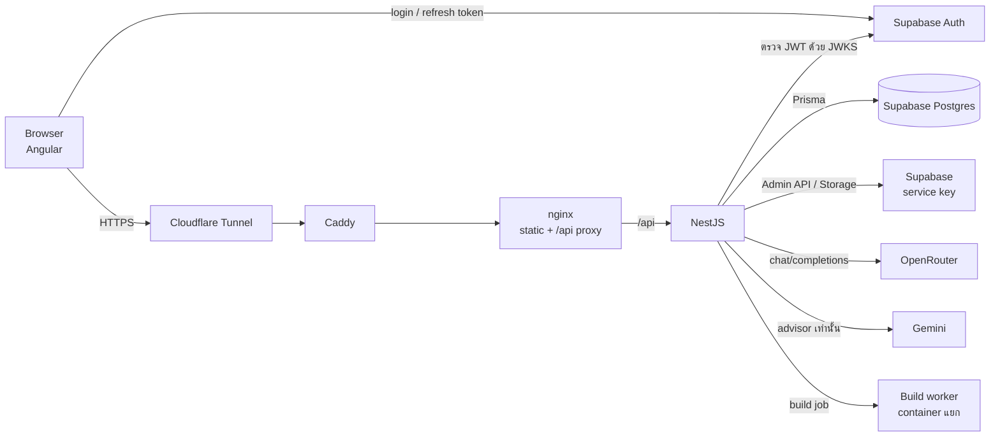

# สรุปโค้ด IoT Hub

ไฟล์ในโฟลเดอร์นี้อธิบายว่าระบบหลักทำงานอย่างไร โค้ดอยู่ไฟล์ไหน บรรทัดไหน
เลขบรรทัดอ้างอิงจากโค้ด ณ วันที่ 2026-10-07 ถ้าแก้โค้ดภายหลัง เลขบรรทัดอาจเลื่อน

| ไฟล์ | เรื่อง |
| --- | --- |
| [01-backend-connection.md](01-backend-connection.md) | Angular เรียก NestJS อย่างไร ตั้งแต่ browser → Cloudflare → Caddy → nginx → NestJS |
| [02-supabase.md](02-supabase.md) | Login ผ่าน Supabase Auth, ตรวจ token ที่ backend, ฐานข้อมูลผ่าน Prisma, Storage |
| [03-project-creation.md](03-project-creation.md) | สร้างโปรเจกต์แบบ manual และแบบ AI |
| [04-ai-flow.md](04-ai-flow.md) | ถาม AI หรือสั่งให้ AI ทำงาน: tool loop, แผน (plan), การ apply |
| [05-openrouter.md](05-openrouter.md) | เชื่อม OpenRouter อย่างไร เลือกโมเดลอย่างไร และ Gemini fallback |
| [06-devices-and-wiring.md](06-devices-and-wiring.md) | สร้างอุปกรณ์ (device catalog) วางบน canvas และต่อสาย |
| [07-ai-step-by-step.md](07-ai-step-by-step.md) | ไล่ทีละขั้นตั้งแต่ prompt: datasheet, เลือกขา, ขาที่เป็น text กลายเป็นเส้นบนจอ, จำลองโค้ดใน browser และ build/flash จริง |

## ภาพรวมทั้งระบบ

กติกาสำคัญที่เห็นในทุกไฟล์:

- Controller ทำเฉพาะเรื่อง HTTP, Service ถือ business logic, Repository คุยกับฐานข้อมูล
- สิทธิ์ตรวจที่ backend เสมอ (`SupabaseAuthGuard` + `AuthorizationService`) ฝั่ง frontend ซ่อนปุ่มเพื่อ UX เท่านั้น
- AI ไม่เคยแก้โปรเจกต์โดยตรง AI สร้าง "แผน" ก่อน ผู้ใช้กดยอมรับ แล้ว backend ตรวจแผนซ้ำก่อนเขียนจริง
- โค้ดของผู้ใช้ไม่รันใน process ของ NestJS การ build firmware รันใน container แยก
